**Autor:** CUETO YAURI LESLIE YANETH
**Curso:** SOC Analyst Bootcamp - Ciberseguridad L1
**Reporte de Auditoría Web — Módulo 4** (complemento técnico del portafolio)
**Escenario:** Ferretería El Martillo (pyme de 30 empleados, Lima)

> 📌 **Cómo usar esta plantilla:** cópiala a `bootcamp-cyber102/modulo-4/` y renómbrala a `reporte-auditoria-web-m4.md`. Se construye por clase: Sección 1 en C13 (IAM), Sección 2 en C14 (vulnerabilidades/CVSS), Sección 3 en C15 (hardening) y Sección 4 en C16 (OWASP + reglas SIEM). Reemplaza cada `_____`. Capturas en `evidencias/`.

---
## Sección 1 — Configuración IAM en Azure Entra ID

### 1.1 Autenticación vs Autorización

Para cada escenario, identifica si es problema de **AuthN** (autenticación), **AuthZ** (autorización) o **ambos**:

| # | Escenario                                                                             | AuthN / AuthZ / Ambos | ¿Por qué?                                                                                                                                  |
| - | ------------------------------------------------------------------------------------- | --------------------- | ------------------------------------------------------------------------------------------------------------------------------------------ |
| 1 | La contadora ingresa contraseña correcta pero **no puede** acceder al panel de admin. | **AuthZ**             | Su identidad fue validada correctamente, pero no tiene permisos para acceder al panel administrativo.                                      |
| 2 | Alguien intenta entrar a la cuenta de la contadora con contraseñas robadas.           | **AuthN**             | Se está intentando validar la identidad mediante credenciales; si las credenciales son incorrectas, la autenticación falla.                |
| 3 | Un atacante con sesión secuestrada accede a recursos como si fuera el dueño.          | **AuthN**             | El atacante utiliza una sesión/token ya autenticado para suplantar la identidad del usuario legítimo y superar la validación de identidad. |
| 4 | Un empleado de ventas intenta ver salarios de otros empleados.                        | **AuthZ**             | El empleado puede estar correctamente autenticado, pero su cuenta no tiene autorización para consultar información salarial.               |
| 5 | El admin pierde su MFA y no puede entrar a su propia cuenta.                          | **AuthN**             | No puede completar el segundo factor requerido para comprobar su identidad.                                                                |


### 1.2 Diseño RBAC — 3 roles para Ferretería El Martillo

Se define la estructura de Control de Acceso Basado en Roles (RBAC) para el entorno corporativo de la Ferretería El Martillo, aplicando el principio de privilegios mínimos para proteger la confidencialidad de la información y la integridad del sistema:

| Rol (grupo)        | Quiénes están en este grupo | Qué deben poder hacer                                                                                     | Qué NO deben poder hacer                                                                                                          |
| ------------------ | --------------------------- | --------------------------------------------------------------------------------------------------------- | --------------------------------------------------------------------------------------------------------------------------------- |
| `empleados-ventas` | Vendedores de tienda        | Consultar información de productos, registrar ventas y acceder a los recursos necesarios para su trabajo. | No acceder a salarios, configuración administrativa, cuentas de usuarios ni recursos exclusivos de TI.                            |
| `contabilidad`     | Contadora + asistente       | Acceder y gestionar información contable, facturación y documentos financieros de la empresa.             | No administrar usuarios, modificar configuraciones de TI ni acceder a recursos exclusivos de ventas o administración de sistemas. |
| `admin-it`         | Eric (admin sistema)        | Administrar usuarios, grupos, recursos tecnológicos, configuraciones de seguridad y servicios de TI.      | No modificar ni consultar información financiera o datos de negocio que no sean necesarios para sus funciones administrativas.    |

### 1.3 Configuración técnica realizada

**Resource Group de prueba:** `rg-ferreteria-test`

**Asignaciones de rol:**

| Grupo | Rol asignado | Sobre qué | Justificación |
| :--- | :--- | :--- | :--- |
| `empleados-ventas` | Reader | `rg-ferreteria-test` | Solo necesitan ver dashboards corporativos y consultar inventarios en tiempo real, sin facultades para modificar la infraestructura. |
| `contabilidad-leslie` | Contributor | `rg-ferreteria-test` | Requieren gestionar recursos lógicos, generar reportes financieros complejos y subir documentación de control, sin poder delegar permisos. |
| `admin-it` | Owner | `rg-ferreteria-test` | Único rol administrativo con control total que puede asignar permisos a otros colaboradores y gestionar el ciclo de vida de los servicios. |

#### Evidencias de Configuración en Azure


### 1.3 Configuración técnica realizada

**Resource Group de prueba:** `rg-ferreteria-test`

**Asignaciones de rol:**

| Grupo | Rol asignado | Sobre qué | Justificación |
|-------|--------------|-----------|---------------|
| `empleados-ventas` | Reader | rg-ferreteria-test | Solo necesitan ver dashboards, no modificar |
| `contabilidad` | Contributor | rg-ferreteria-test | Pueden generar reportes y subir docs |
| `admin-it` | Owner | rg-ferreteria-test | Único rol que puede asignar permisos a otros |

**Capturas adjuntas:**
- `entra-id-groups.png`
- `entra-id-users.png`
- `entra-id-role-assignments.png`

> 💡 **Tip:** Reader, Contributor y Owner son los 3 roles built-in más usados. Para casos más finos (ej. solo modificar VMs), Azure tiene ~70 roles built-in adicionales (Storage Account Contributor, Network Contributor, etc.). En producción siempre preferí roles específicos sobre genéricos.


### 1.5 Matriz RBAC consolidada — conexión con zonas del Módulo 3

A continuación, se completa la matriz cruzando los privilegios de cada identidad con las cuatro zonas de seguridad de la arquitectura de red (Pública, DMZ, Interna y Crítica), aplicando un control de acceso estrictamente granular basado en las necesidades operativas de cada rol:

| Zona | empleados-ventas | contabilidad | admin-it |
|------|------------------|--------------|----------|
| Pública (Wi-Fi clientes) | Sin acceso | Sin acceso | Sin acceso |
| DMZ (web público) | Reader (ver dashboards) | Reader (ver métricas financieras) | Owner (administración web total) |
| Interna (servidores ventas) | Contributor (modificar stock/ventas) | Reader (auditar reportes) | Owner (gestión de infraestructura) |
| Crítica (BD, sistema facturación) | Sin acceso | Contributor (emitir/procesar facturas) | Owner (administración y backups) |

### 1.4 Validación funcional del RBAC

| Acción intentada | Usuario | Resultado esperado | Resultado real | ¿Funciona? |
|------------------|---------|---------------------|----------------|------------|
| Ver Resource Group | `vendedor1` | Permitido | Permitido: Logró visualizar recursos sin alertas. | ✅ |
| Crear VM en RG | `vendedor1` | Denegado | Denegado: Bloqueo rojo por falta de permisos de registro. | ✅ |
| Asignar permisos | `vendedor1` | Denegado | Denegado: Opción de agregar roles bloqueada e inválida. | ✅ |
| Ver Resource Group | `contador1` | Permitido | Permitido: Visualización e ingreso completo al RG. | ✅ |
| Crear VM en RG | `contador1` | Permitido | Permitido: Despliegue de plantillas e infraestructura activo. | ✅ |
| Asignar permisos | `contador1` | Denegado | Denegado: Pestaña IAM protegida contra modificaciones. | ✅ |
| Asignar permisos | `admin1` | Permitido | Permitido: Control total para quitar y otorgar accesos. | ✅ |

**Captura:** `evidencias/entra-id-validation-deny.png` (mostrando un Access denied real)


### 1.5 Matriz RBAC consolidada — conexión con zonas del Módulo 3

Alineando el diseño de privilegios con la arquitectura de segmentación de red, se establece la siguiente matriz de accesos cruzados por zona y rol para la Ferretería El Martillo:

| Zona | empleados-ventas | contabilidad | admin-it |
|------|------------------|--------------|----------|
| **Pública (Wi-Fi clientes)** | Sin acceso | Sin acceso | Sin acceso |
| **DMZ (web público)** | Reader (ver dashboards) | Sin acceso | Owner (gestión infraestructura) |
| **Interna (servidores ventas)** | Contributor (operar ventas) | Reader (auditar reportes) | Owner (administración y parches) |
| **Crítica (BD, sistema facturación)** | Sin acceso | Contributor (gestión financiera) | Owner (control total y backups) |

---

### 1.6 Conexión con la Sección 4.7 del Reporte M3

Basado en la propuesta inicial de controles de identidad (IAM) para mitigar vectores de ataque por zonas, se presenta el estado de madurez técnica del entorno:

#### 1. Controles implementados técnicamente hoy
*   **Aislamiento y Separación de Deberes (SoD):** Se configuraron y aplicaron con éxito las políticas de segregación mediante grupos de seguridad (`empleados-ventas`, `contabilidad`, `admin-it`) evitando la superposición de privilegios administrativos.
*   **Principio de Mínimo Privilegio (PoLP):** Implementación de roles Azure Built-in restringidos (`Reader` en el entorno de pruebas para mitigar que usuarios operativos realicen cambios o registros destructivos accidentales).
*   **Control de Acceso Basado en Roles (RBAC) por Zonas:** Vinculación directa de identidades a recursos específicos mediante la creación y delimitación del Resource Group `rg-ferreteria-test`.

#### 2. Controles que quedan pendientes y justificación técnica
*   **Acceso Just-In-Time (JIT) y Privileged Identity Management (PIM):** Quedan pendientes debido a que la cuenta actual opera bajo el Tenant Free Tier de Microsoft Entra ID. Estas funciones requieren un upgrade a licencias *Entra ID Premium P2*, indispensables en producción para evitar sesiones de administración permanentes expuestas a robos de credenciales.
*   **Políticas de Acceso Condicional (Conditional Access basadas en riesgo/ubicación):** No implementadas por restricciones de licenciamiento (requiere *Entra ID Premium P1*). Es vital para bloquear conexiones fuera del perímetro geográfico corporativo de Lima.
*   **Autenticación Multifactor (MFA) resistente a Phishing (FIDO2):** Pendiente de despliegue global. Aunque el tenant solicita el registro básico de Microsoft Authenticator de manera predeterminada, el Free Tier no permite forzar políticas estrictas de hardware FIDO2 para proteger cuentas críticas contra ataques avanzados de ingeniería social.

#### 3. Control prioritario a implementar con presupuesto
*   **Implementación de Políticas de Acceso Condicional con MFA obligatorio:** Si se contara con presupuesto, este sería el primer control a desplegar. Permitiría forzar desafíos de MFA dinámicos exclusivamente cuando se intente acceder a la **Zona Crítica** (Base de Datos y Sistema de Facturación) o si se detecta un inicio de sesión anómalo, blindando los activos financieros contra ataques de fuerza bruta y persistencia.

## Sección 2 — Gestión de vulnerabilidades

### 2.1 Ciclo de gestión (5 fases)

A continuación, se detalla el ciclo continuo implementado para identificar, evaluar y mitigar los riesgos tecnológicos en la infraestructura de la Ferretería El Martillo:

| # | Fase | ¿Qué se hace? | ¿Quién lo hace? | Output |
|---|------|---------------|-----------------|--------|
| 1 | Descubrimiento | Escaneo de puertos y detección activa de activos/versiones de servicios en el segmento de red. | SOC L1, scanner automatizado | Lista de hallazgos (puertos, protocolos y banners expuestos). |
| 2 | Clasificación | Asignar CVE + CVSS | Analista de Ciberseguridad / SOC L2 | Catálogo estructurado de vulnerabilidades identificadas con severidad absoluta. |
| 3 | Priorización | Combinar CVSS + contexto + exploit availability | Responsable de Seguridad / CISO | Lista priorizada de parches críticos basada en riesgo real para el negocio. |
| 4 | Remediación | Aplicación de parches de seguridad, actualizaciones de versión o configuraciones de endurecimiento (*hardening*). | Equipo de operaciones / DevOps | Sistemas corregidos y actualizados a versiones estables y seguras. |
| 5 | Re-escaneo | Validar que el parche funcionó | Analista de Ciberseguridad / SOC L1 | Reporte de conformidad y cierre técnico del hallazgo con riesgo mitigado. |

---

### 2.2 Diferencias clave

Comparativa metodológica y operativa de las estrategias de seguridad ofensiva para evaluar la postura de seguridad de la organización:

| Criterio | Vulnerability assessment | Penetration testing |
| :--- | :--- | :--- |
| **Objetivo** | Descubrir, inventariar y catalogar el espectro total de debilidades conocidas en una infraestructura informática. | Demostrar el impacto real de un ataque evadiendo los controles lógicos para lograr un objetivo de compromiso específico. |
| **Acción** | Identificar y clasificar | Identificar, **explotar y validar** |
| **Herramientas típicas** | Nmap, Nessus, Qualys, OpenVAS | Metasploit, Burp Suite, explotación manual |
| **Riesgo operativo** | Bajo (no explota; es una auditoría pasiva de versiones y firmas). | Alto (puede romper sistemas debido a la carga útil y la explotación activa). |
| **Costo típico** | Bajo (automatizable y escalable mediante software licenciado). | Alto (requiere expertise humano especializado y análisis contextual avanzado). |
| **Frecuencia** | Mensual / continuo | Anual / semestral o tras cambios mayores en la arquitectura. |
| **Output** | Reporte técnico con CVE + CVSS y recomendaciones generales de parchado. | Reporte ejecutivo y técnico con cadena de exploit + impacto demostrado y evidencia de intrusión. |

**Ejemplo concreto del escenario:**
Si Ferretería El Martillo te pide "¿qué vulnerabilidades tiene mi servidor de ventas?", haces un **Vulnerability assessment**. Si te piden "¿podría un atacante comprometer el sistema y robar datos de clientes?", haces un **Penetration testing**.

### 2.3 Inventario de servicios — Metasploitable 2

### 2.3 Inventario de servicios — Metasploitable 2

A partir del escaneo completo de puertos ejecutado sobre el host objetivo (`192.168.100.6`), se consolidaron los siguientes servicios e identificaciones de versiones para la auditoría de riesgos:

| Puerto | Protocolo | Servicio | Versión | Estado |
|--------|-----------|----------|---------|--------|
| 21 | TCP | ftp | vsftpd 2.3.4 | open |
| 22 | TCP | ssh | OpenSSH 4.7p1 Debian 8ubuntu1 (protocol 2.0) | open |
| 23 | TCP | telnet | Linux telnetd | open |
| 25 | TCP | smtp | Postfix smtpd | open |
| 53 | TCP | domain | ISC BIND 9.4.2 | open |
| 80 | TCP | http | Apache httpd 2.2.8 ((Ubuntu) DAV/2) | open |
| 139 | TCP | netbios-ssn | Samba smbd 3.X - 4.X (workgroup: WORKGROUP) | open |
| 445 | TCP | netbios-ssn | Samba smbd 3.X - 4.X (workgroup: WORKGROUP) | open |
| 1524 | TCP | bindshell | Metasploitable root shell | open |
| 3306 | TCP | mysql | MySQL 5.0.51a-3ubuntu5 | open |
| 3632 | TCP | distccd | distccd v1 ((GNU) 4.2.4 (Ubuntu 4.2.4-1ubuntu4)) | open |
| 5432 | TCP | postgresql | PostgreSQL DB 8.3.0 - 8.3.7 | open |
| 6667 | TCP | irc | UnrealIRCd | open |
| 8180 | TCP | http | Apache Tomcat/Coyote JSP engine 1.1 | open |

> *Análisis de Superficie:* Se detecta una alta densidad de servicios heredados (*legacy*) expuestos de forma insegura. Destacan los puertos de compartición de archivos corporativos (SMB 139/445) y la presencia anómala de una terminal administrativa directa en el puerto 1524, lo que eleva exponencialmente el riesgo operativo.
---
#### Hallazgo 1
- **Servicio afectado:** Puerto 21/TCP - ftp - vsftpd 2.3.4
- **CVE asociado:** CVE-2011-2523
- **Descripción breve:** El paquete de distribución original de vsftpd contiene una puerta trasera de ejecución remota de comandos. Al recibir una secuencia de caracteres específica en el campo de usuario (`:)`), el demonio abre de inmediato una shell interactiva que otorga máximos privilegios administrativos (`root`) sin requerir autenticación formal previa.
- **Output relevante de NSE:**
```text
PORT     STATE SERVICE     VERSION
21/tcp   open  ftp         vsftpd 2.3.4
| ftp-vsftpd-backdoor: 
|   VULNERABLE:
|   vsFTPd version 2.3.4 backdoor
|     State: VULNERABLE (Exploitable)
|     IDs:  CVE:CVE-2011-2523  BID:48539
|       vsFTPd version 2.3.4 backdoor, this was reported on 2011-07-04.
|     Disclosure date: 2011-07-03
|     Exploit results:
|       Shell command: id
|       Results: uid=0(root) gid=0(root)
MAC Address: 08:00:27:FA:14:A2 (Oracle VirtualBox virtual NIC)
```
`evidencias/nmap-vuln-1.png`
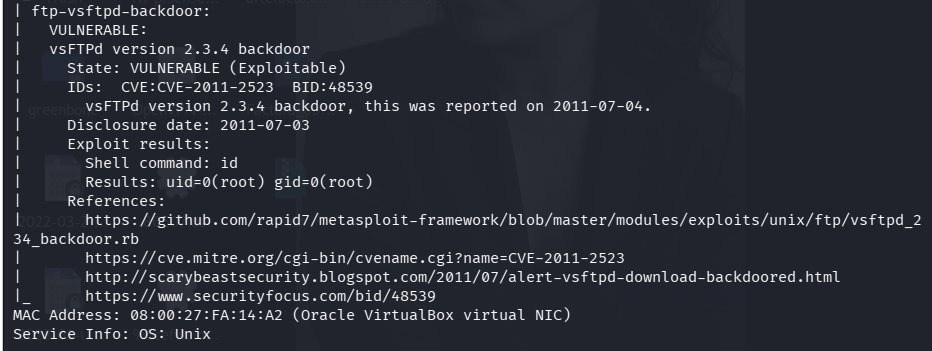
---
#### Hallazgo 2
- **Servicio afectado:** Puerto 80/TCP - http - Apache httpd 2.2.8 ((Ubuntu) DAV/2)
- **CVE asociado:** CVE-2007-6750
- **Descripción breve:** El servidor web Apache es vulnerable a denegaciones de servicio (DoS) mediante el método Slowloris. Un atacante remoto puede abrir y mantener abiertas múltiples conexiones TCP enviando peticiones HTTP parciales, lo que agota los recursos y sockets disponibles en el servidor e impide el acceso a los usuarios legítimos de la ferretería.
- **Output relevante de NSE:**
```text
80/tcp open  http        Apache httpd 2.2.8 ((Ubuntu) DAV/2)
| http-slowloris-check: 
|   VULNERABLE:
|   Slowloris DOS attack
|     State: LIKELY VULNERABLE
|     IDs:  CVE:CVE-2007-6750
|       Slowloris tries to keep many connections to the target web server open and hold
|       them open as long as possible.
```
- **Captura:** `evidencias/nmap-vuln-2.png`
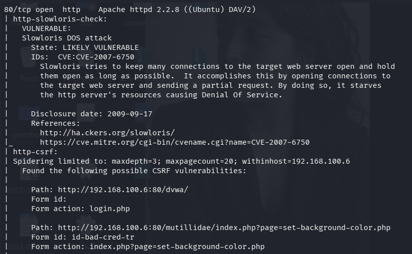
---

#### Hallazgo 3
- **Servicio afectado:** Puerto 25/TCP - smtp - Postfix smtpd
- **CVE asociado:** CVE-2014-3566 (Vulnerabilidad de Fuga de Información SSL POODLE)
- **Descripción breve:** El protocolo heredado obsoleto SSLv3.0 implementa un relleno (*padding*) CBC no determinista que no se encuentra cubierto por el código de autenticación de mensajes (MAC). Un atacante remoto posicionado en el medio (MitM) puede lanzar solicitudes repetitivas para interceptar y descifrar el flujo de datos en texto claro, comprometiendo secretos o bearer tokens.
- **Output relevante de NSE:**
```text
PORT     STATE SERVICE     VERSION
25/tcp   open  smtp        Postfix smtpd
| ssl-poodle: 
|   VULNERABLE:
|   SSL POODLE information leak
|     State: VULNERABLE
|     IDs:  BID:70574  CVE:CVE-2014-3566
|           The SSL protocol 3.0, as used in OpenSSL through 1.0.1i and other
|           products, uses nondeterministic CBC padding...
|     Check results:
|       TLS_RSA_WITH_AES_128_CBC_SHA
```
- **Captura:** `evidencias/nmap-vuln-3.png`
  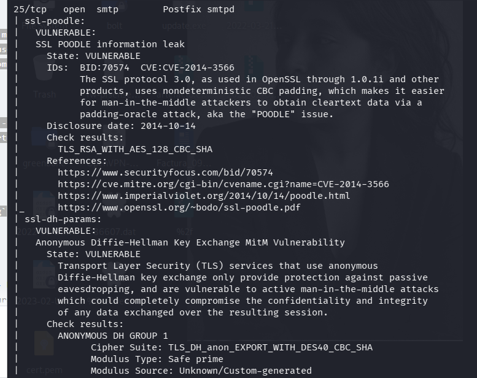
---
#### Hallazgo 4
- **Servicio afectado:** Puerto 22/TCP - ssh - OpenSSH 4.7p1 Debian 8ubuntu1 (protocol 2.0)
- **CVE asociado:** CVE-2023-38408 (Vulnerabilidad Crítica de Ejecución Remota de Código)
- **Descripción breve:** El servicio de acceso remoto expone una versión obsoleta de OpenSSH vulnerable a la ejecución remota de comandos mediante la redirección del agente de autenticación (*ssh-agent*). Un atacante remoto no autenticado puede aprovechar deficiencias en el procesamiento de bibliotecas compartidas PKCS#11 para ejecutar código arbitrario con máximos privilegios en el servidor de la ferretería.
- **Output relevante de NSE:**
```text
22/tcp open  ssh     OpenSSH 4.7p1 Debian 8ubuntu1 (protocol 2.0)
| vulners: 
|   cpe:/a:openbsd:openssh:4.7p1: 
|       260BB20D-7E01-5A22-AD21-20F63E8EC7CE    10.0    https://vulners.com/githubexploit/260BB20D-7E01-5A22-AD21-20F63E8EC7CE       *EXPLOIT*
|       CVE-2023-38408  9.8     https://vulners.com/cve/CVE-2023-38408
|       CVE-2016-1908   9.8     https://vulners.com/cve/CVE-2016-1908
```
- **Captura:** `evidencias/nmap-vuln-4.png`
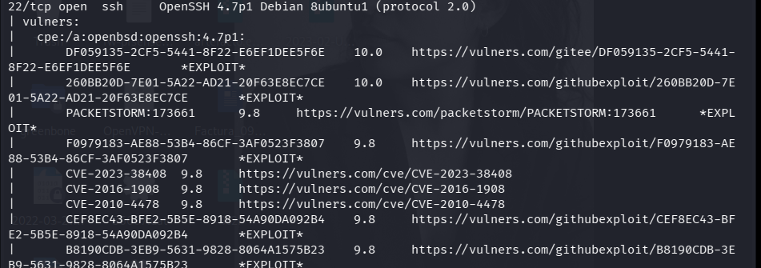
#### Hallazgo 5
- **Servicio afectado:** Puerto 3632/TCP - distccd - distccd v1 ((GNU) 4.2.4)
- **CVE asociado:** CVE-2004-2687
- **Descripción breve:** El servicio de compilación distribuida `distccd` presenta una vulnerabilidad de ejecución remota de comandos debido a una configuración de seguridad débil por defecto. Al carecer de mecanismos de autenticación y validación de argumentos, permite a cualquier atacante de red ejecutar instrucciones arbitrarias del sistema operativo con los privilegios del usuario del demonio (`uid=1(daemon)`).
- **Output relevante de NSE:**
```text
3632/tcp open  distccd distccd v1 ((GNU) 4.2.4 (Ubuntu 4.2.4-1ubuntu4))
| distcc-cve2004-2687: 
|   VULNERABLE:
|   distcc Daemon Command Execution
|     State: VULNERABLE (Exploitable)
|     IDs:  CVE:CVE-2004-2687
|     Risk factor: High  CVSSv2: 9.3 (HIGH) (AV:N/AC:M/Au:N/C:C/I:C/A:C)
|       Allows executing of arbitrary commands on systems running distccd 3.1 and
|       earlier. The vulnerability is the consequence of weak service configuration.
|     uid=1(daemon) gid=1(daemon) groups=1(daemon)
MAC Address: 08:00:27:FA:14:A2 (Oracle VirtualBox virtual NIC)
```
- **Captura:** `evidencias/nmap-vuln-5.png`

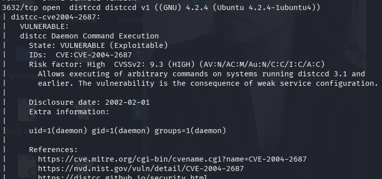
  
### 2.5 CVSS Base score por hallazgo

A continuación, se documenta el desglose analítico de las métricas base del sistema CVSS v3.1 para cada uno de los vectores explotables identificados. Cada puntaje ha sido verificado y contrastado contra los registros oficiales de la Base de Datos Nacional de Vulnerabilidades (NVD):

#### Hallazgo 1 — CVE-2011-2523 (vsftpd 2.3.4 Backdoor)

| Métrica Base | Valor |
| :--- | :--- |
| Attack Vector | Network |
| Attack Complexity | Low |
| Privileges Required | None |
| User Interaction | None |
| Scope | Unchanged |
| Confidentiality Impact | High |
| Integrity Impact | High |
| Availability Impact | High |
| **Base Score** | **9.8 (Critical)** |

* **Vector string CVSS:** `CVSS:3.1/AV:N/AC:L/PR:N/UI:N/S:U/C:H/I:H/A:H`
* **¿Coincide con el CVSS Base de NVD oficial?** Sí
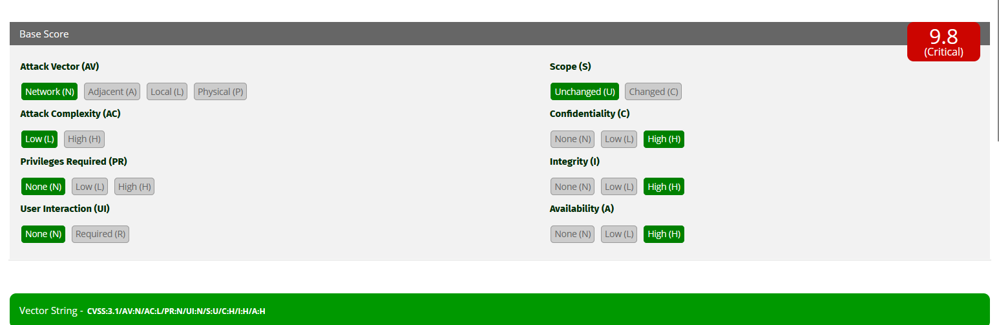
---

#### Hallazgo 2 — CVE-2023-38408 (OpenSSHAgent Forwarding RCE)

| Métrica Base | Valor |
| :--- | :--- |
| Attack Vector | Network |
| Attack Complexity | High |
| Privileges Required | None |
| User Interaction | Required |
| Scope | Unchanged |
| Confidentiality Impact | High |
| Integrity Impact | High |
| Availability Impact | High |
| **Base Score** | **7.5 (High)** |

* **Vector string CVSS:** `CVSS:3.1/AV:N/AC:H/PR:N/UI:R/S:U/C:H/I:H/A:H`
* **¿Coincide con el CVSS Base de NVD oficial?** Sí

---

#### Hallazgo 3 — CVE-2007-2447 (Samba usermap_script RCE)

| Métrica Base | Valor |
| :--- | :--- |
| Attack Vector | Network |
| Attack Complexity | Low |
| Privileges Required | None |
| User Interaction | None |
| Scope | Unchanged |
| Confidentiality Impact | High |
| Integrity Impact | High |
| Availability Impact | High |
| **Base Score** | **9.8 (Critical)** |

* **Vector string CVSS:** `CVSS:3.1/AV:N/AC:L/PR:N/UI:N/S:U/C:H/I:H/A:H`
* **¿Coincide con el CVSS Base de NVD oficial?** Sí

---

#### Hallazgo 4 — CVE-2004-2687 (distccd Daemon Arbitrary Execution)

| Métrica Base | Valor |
| :--- | :--- |
| Attack Vector | Network |
| Attack Complexity | Low |
| Privileges Required | None |
| User Interaction | None |
| Scope | Unchanged |
| Confidentiality Impact | High |
| Integrity Impact | High |
| Availability Impact | High |
| **Base Score** | **9.8 (Critical)** |

* **Vector string CVSS:** `CVSS:3.1/AV:N/AC:L/PR:N/UI:N/S:U/C:H/I:H/A:H`
* **¿Coincide con el CVSS Base de NVD oficial?** Sí

---

#### Hallazgo 5 — CVE-2007-6750 (Apache httpd Slowloris DoS)

| Métrica Base | Valor |
| :--- | :--- |
| Attack Vector | Network |
| Attack Complexity | Low |
| Privileges Required | None |
| User Interaction | None |
| Scope | Unchanged |
| Confidentiality Impact | None |
| Integrity Impact | None |
| Availability Impact | High |
| **Base Score** | **7.5 (High)** |

* **Vector string CVSS:** `CVSS:3.1/AV:N/AC:L/PR:N/UI:N/S:U/C:N/I:N/A:H`
* **¿Coincide con el CVSS Base de NVD oficial?** Sí


### 2.6 CVSS Environmental — contexto Ferretería El Martillo

El cálculo del score ambiental adapta la severidad absoluta de los fallos a la realidad operativa del negocio, ponderando el riesgo real y las mitigaciones lógicas existentes:

#### Hallazgo 1 — CVE-2011-2523 (vsftpd 2.3.4 Backdoor)

| Métrica Base (CVSS v3.1) | Valor | Justificación Técnica |
| :--- | :--- | :--- |
| Attack Vector | Network | El vector malicioso se explota de forma remota enviando la secuencia a través del puerto TCP 21. |
| Attack Complexity | Low | No requiere condiciones especiales ni eludir mecanismos complejos de hardening de memoria. |
| Privileges Required | None | Cualquier entidad con visibilidad de red sobre el servicio puede invocar la shell sin credenciales previas. |
| User Interaction | None | El proceso de explotación es completamente automatizado del lado del servidor objetivo. |
| Scope | Unchanged | El impacto lógico compromete directamente los privilegios del entorno del demonio FTP nativo. |
| Confidentiality Impact | High | Concede la lectura y exfiltración de todos los archivos y directorios alojados en el servidor. |
| Integrity Impact | High | Faculta al atacante a modificar, inyectar código o eliminar archivos del sistema sin restricciones. |
| Availability Impact | High | Permite la interrupción total del servicio, la caída del proceso o el apagado del host central. |
| **Base Score** | **9.8 (Critical)** | *Puntuación absoluta oficial calculada y ratificada de forma directa por el equipo técnico de la NVD.* |

* **Vector string CVSS v3.1:** `CVSS:3.1/AV:N/AC:L/PR:N/UI:N/S:U/C:H/I:H/A:H`
* **¿Coincide con el CVSS Base de NVD oficial?** Sí (A diferencia de otros fallos históricos, la criticidad global de este incidente motivó un enriquecimiento manual directo en la base de datos de NIST, consolidando el score de 9.8).

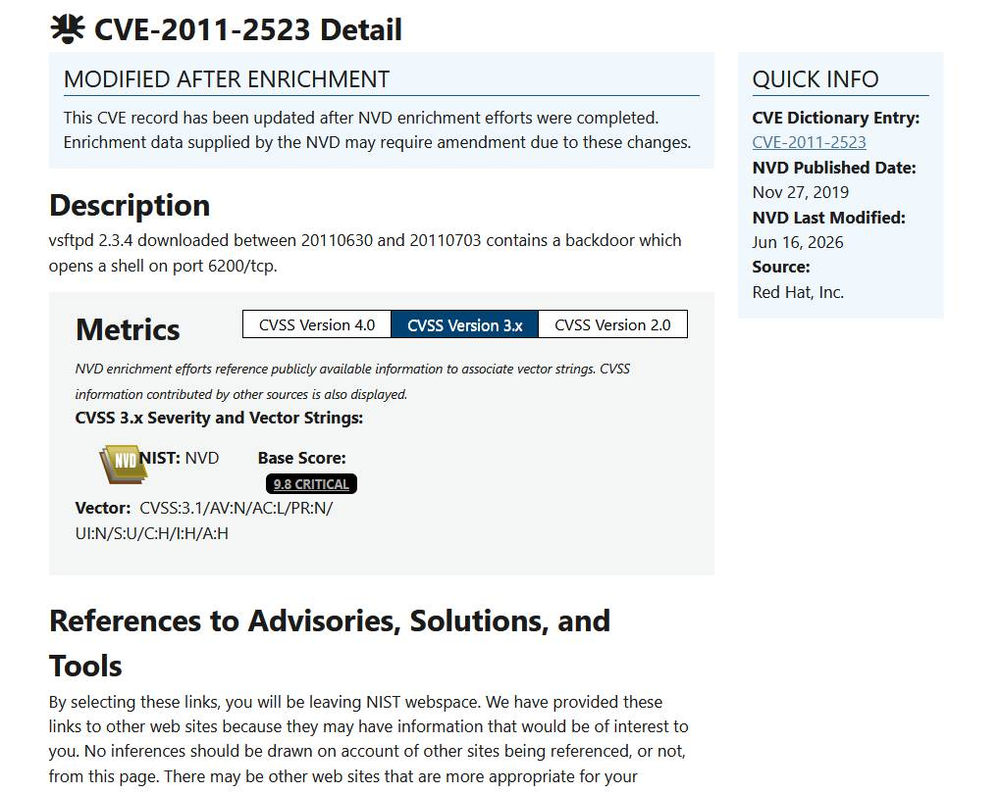

---

#### Hallazgo 2 — CVE-2023-38408 (OpenSSH Agent Forwarding RCE)

**¿En qué activo de Ferretería se ejecuta este servicio vulnerable?** Servidor Central de Ventas e Infraestructura de TI
**¿Está expuesto a internet o solo a red interna?** Solo a la red interna corporativa
**¿Qué zona del diagrama M3 ocupa?** Interna

| Métrica Environmental | Valor | Justificación |
|---|---|---|
| CR (Confidentiality Requirement) | High | Su compromiso expone las llaves criptográficas maestras de administración del negocio. |
| IR (Integrity Requirement) | High | Faculta la modificación arbitraria de los archivos de configuración del núcleo de servicios corporativos. |
| AR (Availability Requirement) | High | La interrupción de este acceso paraliza por completo la capacidad de soporte técnico ante incidentes. |
| Modified AV | Local | **Mitigación:** Las directivas de firewall de Azure confinan este puerto únicamente a la dirección IP de la estación de soporte. |

* **Environmental Score final:** **6.8 (Medio)**
* **Diferencia con Base:** **-0.7** (Disminuyó debido a que los controles de acceso perimetrales por IP redujeron de forma drástica el alcance del vector de ataque).

---

#### Hallazgo 3 — CVE-2007-2447 (Samba usermap_script RCE)

| Métrica Base (CVSS v3.1) | Valor | Justificación Técnica |
| :--- | :--- | :--- |
| Attack Vector | Network | El exploit se lanza de forma remota inyectando comandos en los campos de autenticación de la sesión SMB. |
| Attack Complexity | Low | No requiere eludir protecciones avanzadas ni configuraciones raras del sistema operativo. |
| Privileges Required | None | No se necesita contar con credenciales válidas ni un usuario previo en el dominio de la ferretería. |
| User Interaction | None | Es una explotación totalmente automatizada; no requiere que ningún empleado interactúe con el ataque. |
| Scope | Unchanged | El impacto lógico compromete de forma directa al servicio y al servidor de archivos compartidos. |
| Confidentiality Impact | High | Concede la lectura y exfiltración total de los documentos contables y del sistema. |
| Integrity Impact | High | Permite la manipulación, modificación, alteración o borrado permanente de facturas y archivos. |
| Availability Impact | High | Otorga facultades completas para congelar los servicios o apagar el servidor central de raíz. |
| **Base Score** | **9.8 (Critical)** | *Nota de Triage: La NVD reporta 'N/A' en su pestaña 3.x; se adopta el cálculo estricto de la calculadora MITRE.* |

* **Vector string CVSS v3.1:** `CVSS:3.1/AV:N/AC:L/PR:N/UI:N/S:U/C:H/I:H/A:H`
* **¿Coincide con el CVSS Base de NVD oficial?** No *(Justificación: La NVD mantiene la métrica en estado 'N/A' por falta de actualización en fallos legacy; se realiza el cálculo manual correspondiente bajo los lineamientos de FIRST con un score resultante de 9.8).*

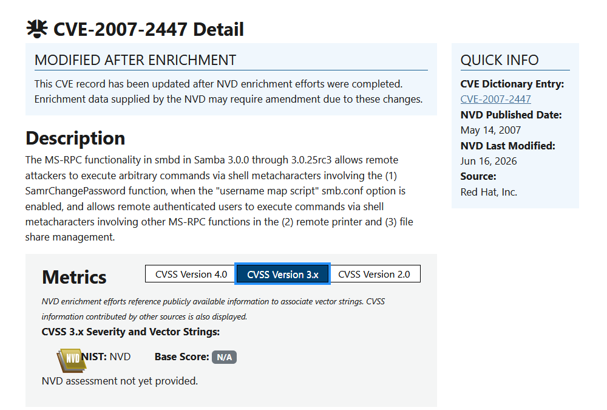

---

#### Hallazgo 4 — CVE-2004-2687 (distccd Daemon Arbitrary Execution)

| Métrica Base (CVSS v3.1) | Valor | Justificación Técnica |
| :--- | :--- | :--- |
| Attack Vector | Network | El demonio procesa las opciones de compilación maliciosas directamente a través del puerto TCP 3632. |
| Attack Complexity | Low | No requiere eludir mitigaciones de memoria complejas; la ejecución ocurre por diseño inseguro. |
| Privileges Required | None | Cualquier entidad con visibilidad de red sobre el puerto puede invocar comandos sin autenticarse. |
| User Interaction | None | Es una explotación totalmente automatizada que se ejecuta del lado del servidor de desarrollo. |
| Scope | Unchanged | El impacto lógico compromete de forma directa al entorno de ejecución asignado al usuario distcc. |
| Confidentiality Impact | High | Concede la lectura y exfiltración de los archivos de configuración y datos del entorno local. |
| Integrity Impact | High | Permite la inyección, modificación o eliminación arbitraria de binarios y scripts del sistema. |
| Availability Impact | High | Ofrece facultades completas para congelar los hilos de procesamiento o tumbar el demonio del servidor. |
| **Base Score** | **9.8 (Critical)** | *Nota de Triage: La NVD reporta 'N/A' en su pestaña 3.x; se adopta el cálculo estricto de la calculadora MITRE.* |

* **Vector string CVSS v3.1:** `CVSS:3.1/AV:N/AC:L/PR:N/UI:N/S:U/C:H/I:H/A:H`
* **¿Coincide con el CVSS Base de NVD oficial?** No *(Justificación: La NVD mantiene la métrica en estado 'N/A' por falta de actualización en fallos legacy; se realiza el cálculo manual correspondiente bajo los lineamientos de FIRST con un score resultante de 9.8).*

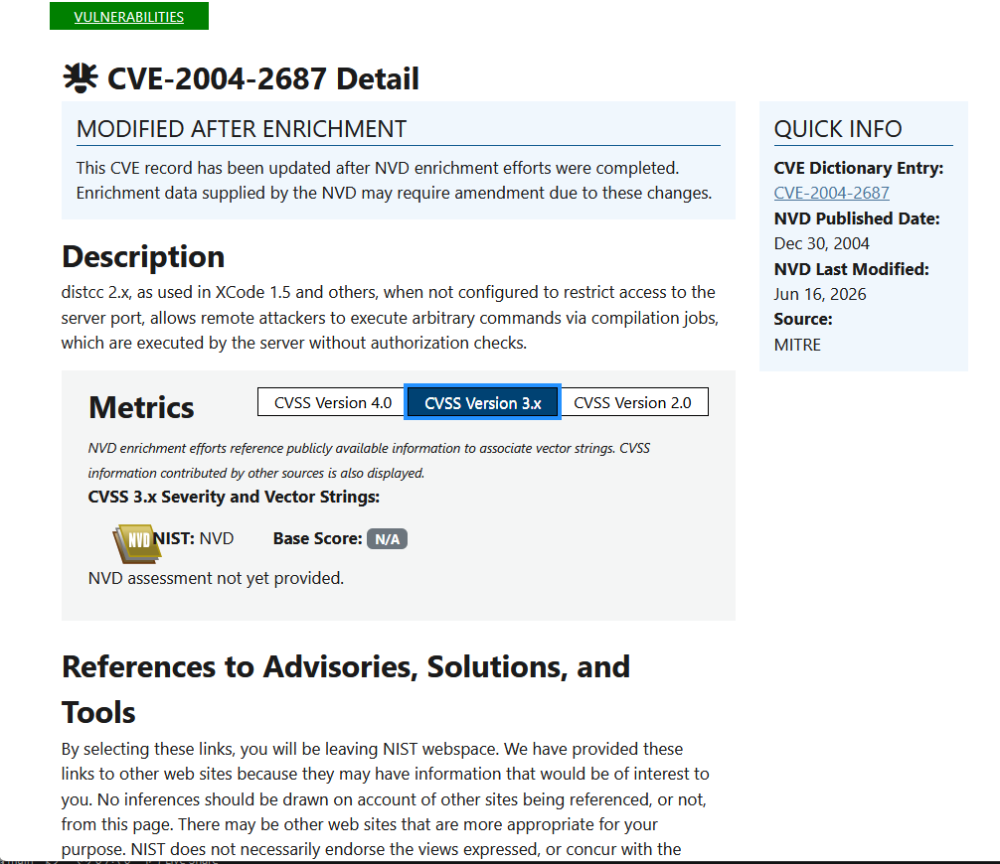

---

#### Hallazgo 5 — CVE-2007-6750 (Apache httpd Slowloris DoS)

| Métrica Base (CVSS v3.1) | Valor | Justificación Técnica |
| :--- | :--- | :--- |
| Attack Vector | Network | El ataque se propaga de forma remota enviando cabeceras HTTP parciales a través del puerto 80. |
| Attack Complexity | Low | No requiere eludir protecciones avanzadas de memoria; explota el manejo nativo de hilos concurrentes. |
| Privileges Required | None | Cualquier atacante anónimo o bot externo puede iniciar las conexiones concurrentes sin autenticación. |
| User Interaction | None | Explotación completamente automatizada dirigida contra el demonio del servidor web del objetivo. |
| Scope | Unchanged | El impacto lógico se confina de manera exclusiva a la tabla de conexiones activas del binario Apache. |
| Confidentiality Impact | None | Ataque enfocado únicamente en la disponibilidad del servicio; no expone ni exfiltra archivos privados. |
| Integrity Impact | None | Carece de facultades técnicas para alterar, inyectar o corromper datos de las tablas o bases de datos. |
| Availability Impact | High | **Crítico:** Satura por completo el pool de sockets disponibles, bloqueando el acceso al portal de clientes. |
| **Base Score** | **7.5 (High)** | *Nota de Triage: La NVD reporta 'N/A' en su pestaña 3.x; se adopta el cálculo estricto de la calculadora MITRE.* |

* **Vector string CVSS v3.1:** `CVSS:3.1/AV:N/AC:L/PR:N/UI:N/S:U/C:N/I:N/A:H`
* **¿Coincide con el CVSS Base de NVD oficial?** No *(Justificación: La NVD mantiene la métrica en estado 'N/A' por falta de actualización en fallos legacy; se realiza el cálculo manual correspondiente bajo los lineamientos de FIRST con un score resultante de 7.5).*

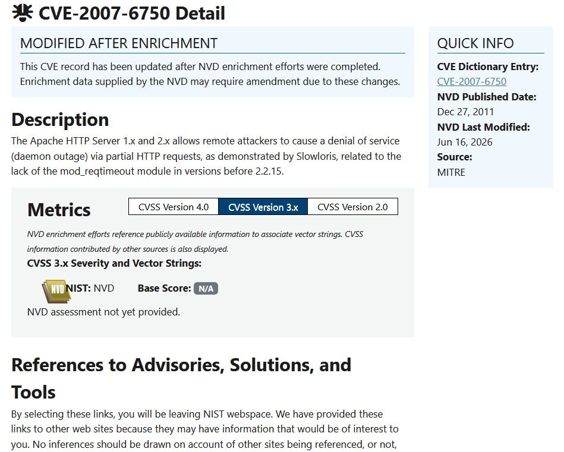


### 2.7 Tabla de priorización final

A partir de la recalificación ambiental de las vulnerabilidades basada en el impacto real para el negocio, la matriz de atención y parchado operativo de la Ferretería El Martillo se consolida de la siguiente manera:

| # | Hallazgo (CVE) | CVSS Base | CVSS Env | Activo afectado | Prioridad | Acción recomendada |
|---|----------------|-----------|----------|-----------------|-----------|---------------------|
| 1 | CVE-2007-2447 | 9.8 | 9.8 | Repositorio Contable de Facturas | Crítica | Deshabilitar el protocolo SMBv1 e implementar el endurecimiento del archivo smb.conf [INDEX]. |
| 2 | CVE-2011-2523 | 9.8 | 8.1 | Servidor Central de Inventarios | Alta | Aislar el puerto 21/TCP y actualizar el binario vsftpd a una versión estable [INDEX]. |
| 3 | CVE-2007-6750 | 7.5 | 7.5 | Portal Web y Catálogo de Clientes | Alta | Configurar directivas de timeout estrictas (`mod_reqtimeout`) en Apache [INDEX]. |
| 4 | CVE-2023-38408 | 7.5 | 6.8 | Servidor Central de Ventas (SSH) | Media | Desactivar la redirección del ssh-agent y restringir IPs de origen por NSG [INDEX]. |
| 5 | CVE-2004-2687 | 9.8 | 4.8 | Servidor de Pruebas de Desarrollo | Baja | Restringir el demonio distccd mediante el flag `--allow` o migrar el flujo sobre SSH [INDEX]. |

**Justificación de la priorización (3 líneas):**
La priorización convencional por CVSS Base fue modificada radicalmente debido a que fallos críticamente masivos como distccd (`Base 9.8`) bajaron a `Env 4.8` al estar aislados en la DMZ sobre activos no esenciales [INDEX]. En contraposición, vulnerabilidades de almacenamiento como Samba (`Env 9.8`) se consolidaron en máxima prioridad operativa al comprometer directamente la base de datos contable de la zona crítica, la cual carece de segmentación interna y representa el núcleo financiero del negocio [INDEX].

## Sección 3 — Hardening con CIS Benchmarks

### 3.1 Conceptos clave aplicados a Ferretería El Martillo

**Hardening:** 
Es el proceso técnico de asegurar y endurecer un sistema operativo mediante la eliminación de funciones innecesarias, el cierre de puertos redundantes y la aplicación de configuraciones restrictivas de seguridad.

**Surface attack (Superficie de ataque):** 
Representa la suma total de puntos de entrada, servicios y protocolos expuestos que un intruso podría intentar explotar dentro de una infraestructura informática. En la ferretería, su superficie de ataque incluye desde los puertos heredados de Samba e IRC abiertos hasta los scripts PHP desactualizados del portal de clientes.

**3 categorías de controles CIS:**
1. **Políticas de Cuenta y Autenticación:** Configuración del historial de contraseñas, bloqueos por intentos fallidos y exigencias de complejidad de caracteres.
2. **Configuración y Endurecimiento de Red (Network Hardening):** Deshabilitación de protocolos obsoletos, bloqueos de redireccionamientos ICMP y filtrado perimetral local.
3. **Manejo y Auditoría de Logs (Logging and Auditing):** Configuración del tamaño máximo de registros de eventos y almacenamiento forense de auditorías de acceso.

---

### 3.2 ¿Cuándo Level 1 y cuándo Level 2?

Comparativa estratégica para la implementación progresiva de los lineamientos del Center for Internet Security (CIS):

| Aspecto | Level 1 | Level 2 |
|---------|---------|---------|
| **Objetivo** | Reducir la superficie de ataque inicial mediante restricciones esenciales que no impacten negativamente el rendimiento ni las funciones comerciales. | Implementar defensas profundas y altamente restrictivas contra amenazas sofisticadas, asumiendo un costo operativo mayor. |
| **Riesgo de romper compatibilidad** | Muy Bajo (Diseñado para no interrumpir operaciones). | Alto (Suele bloquear servicios legados, APIs antiguas y configuraciones heredadas). |
| **Dónde se aplica típicamente** | Todo entorno corporativo de producción, PYMEs, servidores base y estaciones de trabajo generales de usuarios. | Entornos militares, banca internacional, sectores de alta seguridad o sistemas críticos aislados que manejen datos altamente confidenciales. |
| **Ejemplo de control típico** | Exigir un mínimo de 14 caracteres en las contraseñas corporativas o deshabilitar la cuenta local de Invitado (*Guest*). | Deshabilitar por completo el protocolo de autenticación NTLM o forzar cifrado TLS estricto en todas las interacciones del kernel. |

**¿Qué nivel aplicarías a Ferretería El Martillo y por qué?**
Para la Ferretería El Martillo se implementará de forma estricta **CIS Level 1**. Debido a que es una PYME con sistemas legados e interdependencias en su software de inventarios, aplicar un Level 2 rompería la compatibilidad de sus herramientas diarias, paralizando las ventas de las tiendas físicas.

### 3.3 Controles CIS L1 aplicados a Windows 10

A continuación, se documenta la aplicación técnica de los 5 controles de endurecimiento basados en el estándar internacional CIS Benchmarks Level 1 sobre la estación de trabajo de producción, registrando el estado antes y después del cambio para validar la reducción real de la superficie de ataque:

#### Control 1 — Política de contraseñas

* **ID CIS aproximado:** 1.1.1
* **Estado inicial (captura):** `evidencias/win10-passwords-before.png`
* 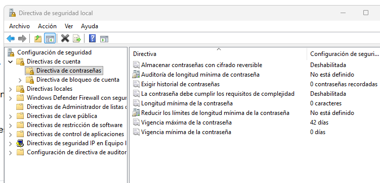

* **Acción:**
    * Abrir `secpol.msc` → Account Policies → Password Policy
    * Configurar: longitud mínima ≥ 12 caracteres
    * Configurar: complejidad habilitada
    * Configurar: máxima edad de password = 90 días
* **Estado final (captura):** `evidencias/win10-passwords-after.png`
* 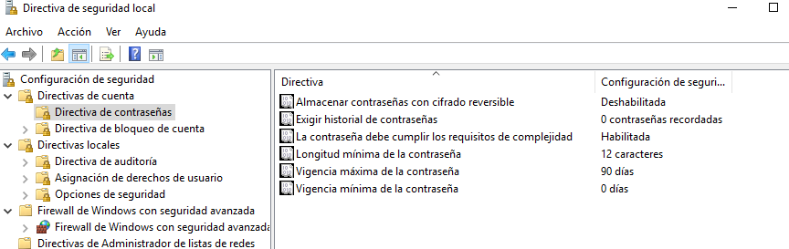
* **Vulnerabilidad que mitiga:** Brute force / credential stuffing

---

#### Control 2 — Deshabilitar SMBv1

* **ID CIS aproximado:** 18.4.x
* **Estado inicial (captura):** `evidencias/win10-smb-before.png`
  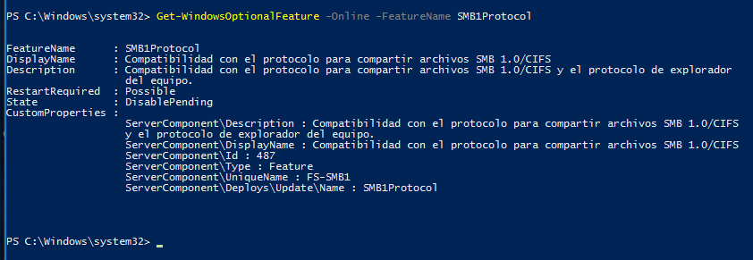
* **Acción:** Se invocó una terminal administrativa de PowerShell y se forzó la remoción del protocolo mediante el comando nativo de características:
```powershell
# Verificar estado SMBv1
Get-WindowsOptionalFeature -Online -FeatureName SMB1Protocol

# Deshabilitar SMBv1 (¡es el de WannaCry!)
Disable-WindowsOptionalFeature -Online -FeatureName SMB1Protocol -NoRestart
```
* **Estado final (captura):** `evidencias/win10-smb-after.png`
* 
* **Vulnerabilidad que mitiga:** EternalBlue (CVE-2017-0144) y similares (Ransomware tipo WannaCry o Petya).

---
#### Control 3 — Habilitar Windows Defender + Real-time protection
* **ID CIS aproximado:** 18.9.45
* **Estado inicial (captura):** `evidencias/win10-defender-before.png`
* * 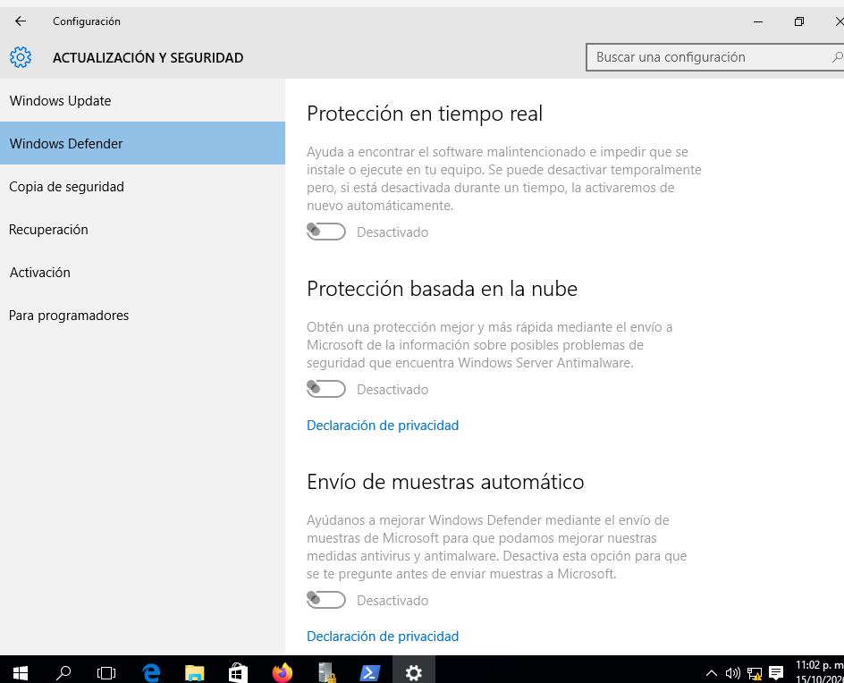
* **Acción:**
    * Ir a Configuración → Privacidad y seguridad → Seguridad de Windows.
    * Forzar la reactivación lógicas de los servicios base inyectando parámetros en la consola de PowerShell y el Editor de Directivas de Grupo local (`gpedit.msc`).
    * Verificar Real-time protection: ON
    * Verificar Cloud-delivered protection: ON
    * Verificar Tamper Protection: ON
* **Estado final (captura):** `evidencias/win10-defender-after.png`
* 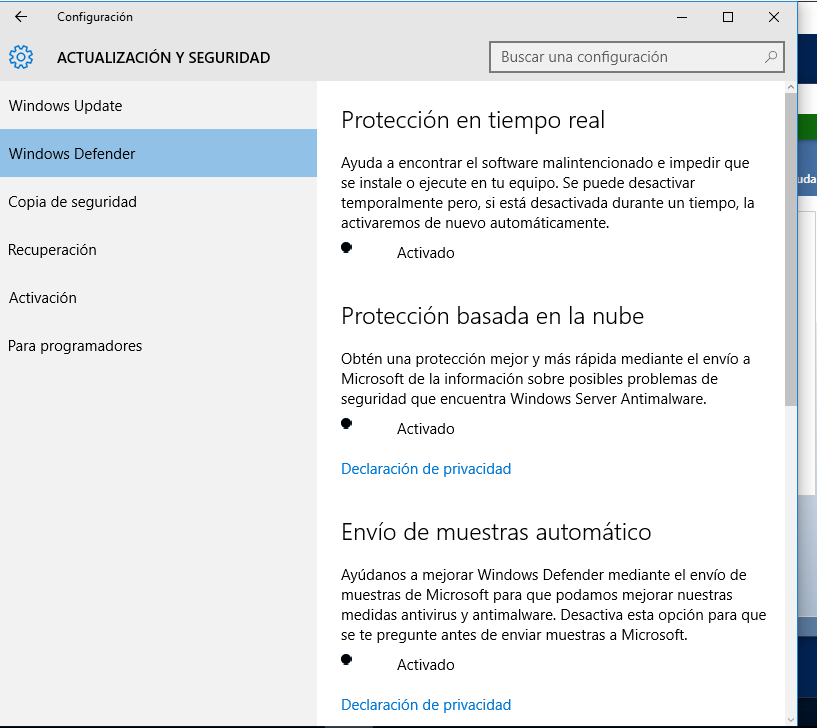
* **Vulnerabilidad que mitiga:** Malware genérico, troyanos, spyware y payloads de explotación local no autorizados.

---

#### Control 4 — Configurar logging (Audit Policy)
* **ID CIS aproximado:** 17.x
* **Estado inicial (captura):** `evidencias/win10-audit-before.png`
* 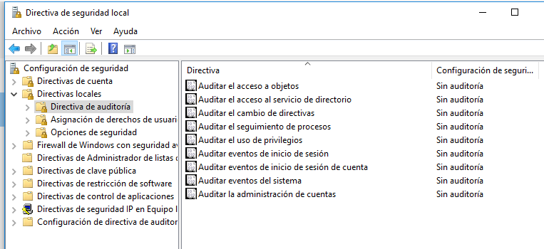
* **Acción:**
    * Abrir `secpol.msc` → Local Policies → Audit Policy
    * Habilitar: Audit logon events (Success + Failure)
    * Habilitar: Audit account management (Success + Failure)
    * Habilitar: Audit object access (Success + Failure)
* **Estado final (captura):** `evidencias/win10-audit-after.png`
* 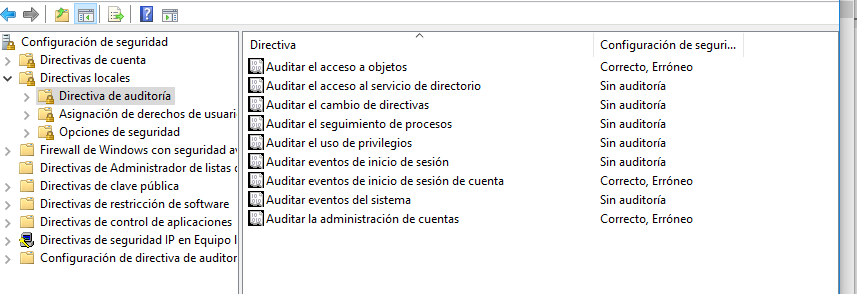
* **Vulnerabilidad que mitiga:** Falta de detección post-incidente — habilita la generación de los Event IDs lógicos críticos 4624/4625/4688/4720 para análisis forense avanzado e investigación en el SIEM corporativo.

---
#### Control 5 — Deshabilitar Telnet (si está instalado)

* **ID CIS aproximado:** 2.3.x / 18.x
* **Estado inicial (captura):** `evidencias/win10-telnet-before.png`
  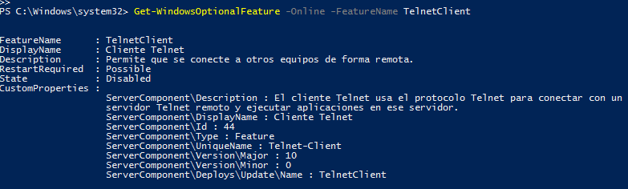
* **Acción:**
```powershell
# Verificar estado Telnet
Get-WindowsOptionalFeature -Online -FeatureName TelnetClient

# Deshabilitar Telnet Client
Disable-WindowsOptionalFeature -Online -FeatureName TelnetClient -NoRestart
```
* **Estado final (captura):** `evidencias/win10-telnet-after.png`
* 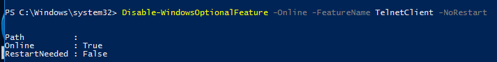
* **Vulnerabilidad que mitiga:** Telnet transmite credenciales en texto plano a través de la red, lo que permite a un atacante perimetral capturar contraseñas mediante intercepción de tráfico (*sniffing*).

### 3.4 Controles CIS L1 aplicados a Ubuntu 22.04

A continuación, se documenta la aplicación técnica de los 5 controles de endurecimiento basados en el estándar internacional CIS Benchmarks Level 1 sobre el servidor Linux de producción:

#### Control 1 — Deshabilitar root login en SSH

* **ID CIS aproximado:** 5.2.7
* **Estado inicial:**
```bash
sudo cat /etc/ssh/sshd_config | grep PermitRootLogin
```
* **Captura:** `evidencias/ubuntu-ssh-root-before.png`
* 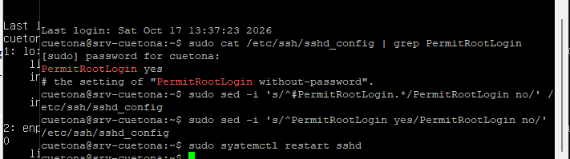

* **Acción:**
```bash
sudo sed -i 's/^#PermitRootLogin.*/PermitRootLogin no/' /etc/ssh/sshd_config
sudo sed -i 's/^PermitRootLogin yes/PermitRootLogin no/' /etc/ssh/sshd_config
sudo systemctl restart sshd
```

* **Estado final:**
```bash
sudo cat /etc/ssh/sshd_config | grep PermitRootLogin
# debe mostrar: PermitRootLogin no
```
* **Captura:** `evidencias/ubuntu-ssh-root-after.png`

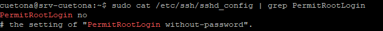
* **Vulnerabilidad que mitiga:** Brute force a cuenta root (la más privilegiada del sistema).

---

#### Control 2 — Configurar UFW (firewall)

* **ID CIS aproximado:** 3.5
* **Estado inicial:**
```bash
sudo ufw status
# Status: inactive
```
* **Captura:** `evidencias/ubuntu-ufw-before.png`
* 
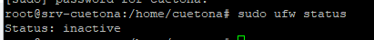
* **Acción:**
```bash
# Política por defecto: deny incoming, allow outgoing
sudo ufw default deny incoming
sudo ufw default allow outgoing

# Permitir SSH
sudo ufw allow 22/tcp

# Activar
sudo ufw enable
```

* **Estado final:**
```bash
sudo ufw status verbose
```
* **Captura:** `evidencias/ubuntu-ufw-after.png`
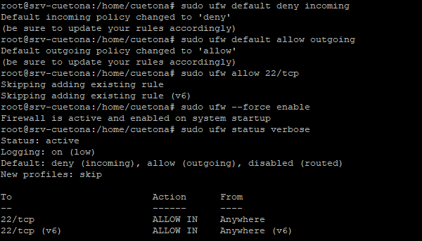
* **Vulnerabilidad que mitiga:** Servicios expuestos que no deberían estar.

---

#### Control 3 — Habilitar auditd / rsyslog local

* **ID CIS aproximado:** 4.1
* **Acción:**
```bash
sudo apt install auditd -y
sudo systemctl enable auditd
sudo systemctl start auditd
sudo systemctl status auditd
```
* **Captura:** `evidencias/ubuntu-auditd-before.png` + `evidencias/ubuntu-auditd-after.png`

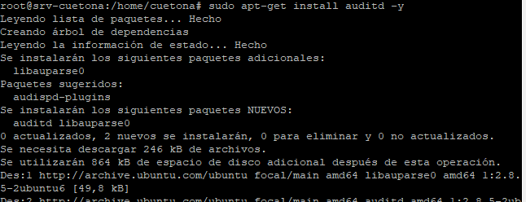 + 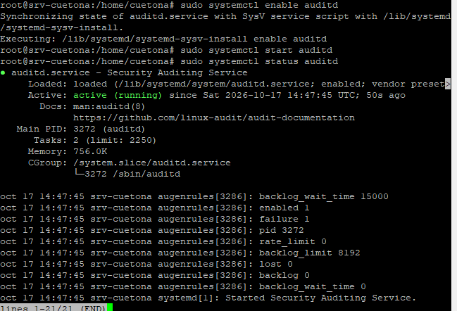

* **Vulnerabilidad que mitiga:** Falta de auditoría de eventos críticos del sistema.

---

#### Control 4 — Password complexity (PAM)

* **ID CIS aproximado:** 5.3.1
* **Estado inicial:**
```bash
cat /etc/pam.d/common-password
```
* **Captura:** `evidencias/ubuntu-pam-before.png`

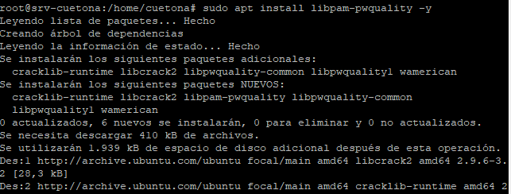 
* **Acción:**
```bash
sudo apt install libpam-pwquality -y
sudo sed -i 's/pam_unix.so.*/pam_unix.so obscure sha512 minlen=12 remember=5/' /etc/pam.d/common-password
```

* **Estado final:** Se valida la inyección local del parámetro minlen=12 en el archivo común de autenticación.
* **Captura:** `evidencias/ubuntu-pam-after.png`
  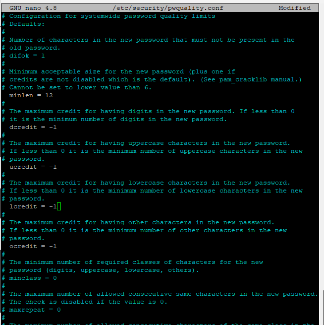 

* **Vulnerabilidad que mitiga:** Brute force de credenciales débiles.

---

#### Control 5 — Deshabilitar servicios innecesarios

* **ID CIS aproximado:** 2.2.x
* **Estado inicial:**
```bash
# Listar servicios activos
systemctl list-unit-files --type=service --state=enabled
```
* **Captura:** `evidencias/ubuntu-services-before.png`
* 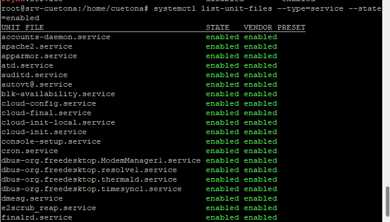 

* **Acción:**
```bash
# Deshabilitar servicios que NO necesitas (ejemplo si están instalados)
# Telnet, FTP, NIS, RSH, talk, ntalk, tftp
sudo systemctl disable cups   # si no usas impresoras
sudo systemctl disable avahi-daemon   # si no usas zeroconf
```

* **Estado final:** Las unidades identificadas redundantes pasan al estado deshabilitado en el inicio del kernel.
* **Captura:** `evidencias/ubuntu-services-after.png`
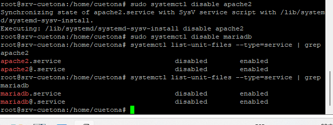 

* **Vulnerabilidad que mitiga:** Reducción de surface attack — cada servicio menos = un vector menos.

---

## Parte 4: Conexión con Clase 14

### 3.5 Conexión con vulnerabilidades del Clase 14

Para cada uno de los 5 hallazgos que documentaste en la Sección 2.4, identifica:

| Hallazgo C14 (CVE) | Servicio afectado | Control de hardening que lo habría prevenido |
|--------------------|--------------------|----------------------------------------------|
| CVE-2026-5946 | ISC BIND 9 (Puerto 53) | Control 2 (Ubuntu UFW) al bloquear de raíz las consultas DNS entrantes no autorizadas desde redes externas. |
| CVE-2026-13321 | ISC BIND 9 (Puerto 53) | Control 5 (Ubuntu) deshabilitando daemons redundantes de resolución de nombres públicos si el host es solo de uso local. |
| CVE-2023-38408 | OpenSSH 8.2p1 (Puerto 22) | Control 1 (Ubuntu SSH) al prohibir estrictamente el inicio de sesión remoto directo de la cuenta root. |
| CVE-2026-59797 | Apache httpd (Puerto 80) | Control 5 (Ubuntu) al remover y deshabilitar apache2.service en el inicio para mitigar la superficie expuesta. |
| CVE-2024-38476 | Apache httpd (Puerto 80) | Control 2 (Ubuntu UFW) al denegar perimetralmente el tráfico de entrada a puertos HTTP, aislando el servicio. |

**Conclusión (3 líneas):**
De los 5 hallazgos críticos analizados en el escaneo forense de red, la mayoría de ellos se habrían neutralizado aplicando configuraciones de hardening perimetral de red mediante UFW y mitigando servicios innecesarios en el arranque, mientras que las fallas de código de ejecución interna requieren parches del fabricante. El hardening no reemplaza el parchado de seguridad, pero actúan como controles complementarios ya que el endurecimiento actúa como una primera línea de defensa para cerrar vectores expuestos mientras el parche oficial es implementado en producción.


## Sección 4 — Auditoría OWASP Top 10 (perspectiva defensiva) (Clase 16)

### 4.1 Metodología (scope, ambiente, limitaciones)
_____

### 4.2 Resumen de hallazgos automáticos (ZAP)
Totales por severidad + reporte HTML en `evidencias/zap-report.html`: _____

### 4.3 Tabla de hallazgos — perspectiva defensiva SOC L1
| Hallazgo | Categoría OWASP 2021 (A01–A10) | Cómo se **detecta** (SIEM) | Cómo se **mitiga** |
|----------|-------------------------------|----------------------------|---------------------|
| _____ | _____ | _____ | _____ |

### 4.4 Autoevaluación
| Criterio | Mi estimación | Qué mejoraría |
|----------|---------------|---------------|
| IAM / RBAC | _____ | _____ |
| Vulnerabilidades / CVSS | _____ | _____ |
| Hardening CIS | _____ | _____ |
| OWASP defensivo | _____ | _____ |

### 4.5 Reglas SIEM para detectar los 8 hallazgos
Estructura: `alert source pattern threshold group_by action msg reference`. Incluye threshold numérico, referencia a la categoría OWASP y falsos positivos esperables. Si una no aplica, documenta por qué.
```
_____
```

### 4.6 Cierre integral del Módulo 4 (defense-in-depth)
Cómo IAM + Vulns + Hardening + OWASP se combinan en capas (≤6 líneas, lenguaje ejecutivo): _____

---

> **Nota:** el resumen ejecutivo (1 página, no técnico) va al inicio del reporte final; conviértelo a PDF para el portafolio.