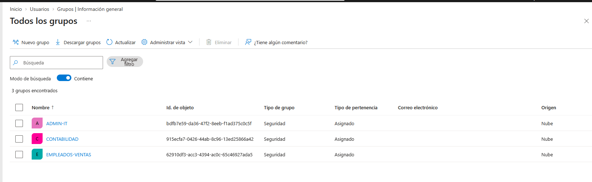
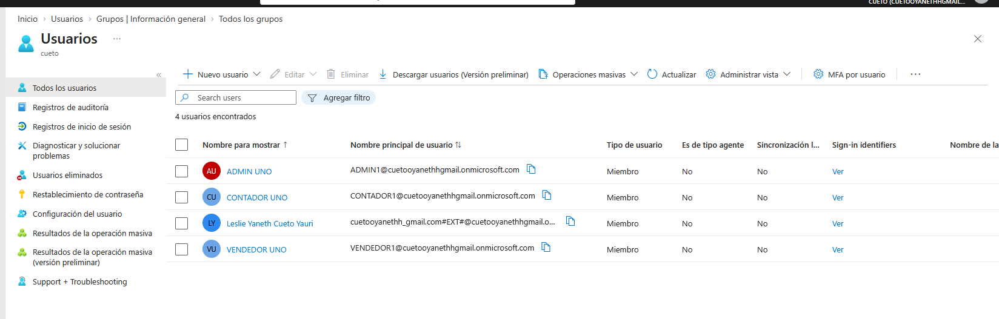
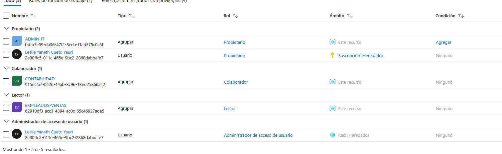
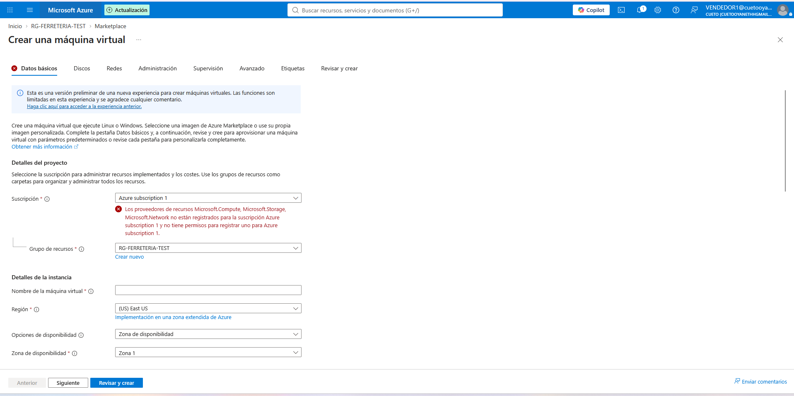

**Autor:** CUETO YAURI LESLIE YANETH
**Curso:** SOC Analyst Bootcamp - Ciberseguridad L1
**Reporte de Auditoría Web — Módulo 4** (complemento técnico del portafolio)
**Escenario:** Ferretería El Martillo (pyme de 30 empleados, Lima)

> 📌 **Cómo usar esta plantilla:** cópiala a `bootcamp-cyber102/modulo-4/` y renómbrala a `reporte-auditoria-web-m4.md`. Se construye por clase: Sección 1 en C13 (IAM), Sección 2 en C14 (vulnerabilidades/CVSS), Sección 3 en C15 (hardening) y Sección 4 en C16 (OWASP + reglas SIEM). Reemplaza cada `_____`. Capturas en `evidencias/`.

---
## Sección 1 — Configuración IAM en Azure Entra ID

### 1.1 Autenticación vs Autorización

Para cada escenario, identifica si es problema de **AuthN** (autenticación), **AuthZ** (autorización) o **ambos**:

| # | Escenario                                                                             | AuthN / AuthZ / Ambos | ¿Por qué?                                                                                                                                  |
| - | ------------------------------------------------------------------------------------- | --------------------- | ------------------------------------------------------------------------------------------------------------------------------------------ |
| 1 | La contadora ingresa contraseña correcta pero **no puede** acceder al panel de admin. | **AuthZ**             | Su identidad fue validada correctamente, pero no tiene permisos para acceder al panel administrativo.                                      |
| 2 | Alguien intenta entrar a la cuenta de la contadora con contraseñas robadas.           | **AuthN**             | Se está intentando validar la identidad mediante credenciales; si las credenciales son incorrectas, la autenticación falla.                |
| 3 | Un atacante con sesión secuestrada accede a recursos como si fuera el dueño.          | **AuthN**             | El atacante utiliza una sesión/token ya autenticado para suplantar la identidad del usuario legítimo y superar la validación de identidad. |
| 4 | Un empleado de ventas intenta ver salarios de otros empleados.                        | **AuthZ**             | El empleado puede estar correctamente autenticado, pero su cuenta no tiene autorización para consultar información salarial.               |
| 5 | El admin pierde su MFA y no puede entrar a su propia cuenta.                          | **AuthN**             | No puede completar el segundo factor requerido para comprobar su identidad.                                                                |


### 1.2 Diseño RBAC — 3 roles para Ferretería El Martillo

Se define la estructura de Control de Acceso Basado en Roles (RBAC) para el entorno corporativo de la Ferretería El Martillo, aplicando el principio de privilegios mínimos para proteger la confidencialidad de la información y la integridad del sistema:

| Rol (grupo)        | Quiénes están en este grupo | Qué deben poder hacer                                                                                     | Qué NO deben poder hacer                                                                                                          |
| ------------------ | --------------------------- | --------------------------------------------------------------------------------------------------------- | --------------------------------------------------------------------------------------------------------------------------------- |
| `empleados-ventas` | Vendedores de tienda        | Consultar información de productos, registrar ventas y acceder a los recursos necesarios para su trabajo. | No acceder a salarios, configuración administrativa, cuentas de usuarios ni recursos exclusivos de TI.                            |
| `contabilidad`     | Contadora + asistente       | Acceder y gestionar información contable, facturación y documentos financieros de la empresa.             | No administrar usuarios, modificar configuraciones de TI ni acceder a recursos exclusivos de ventas o administración de sistemas. |
| `admin-it`         | Eric (admin sistema)        | Administrar usuarios, grupos, recursos tecnológicos, configuraciones de seguridad y servicios de TI.      | No modificar ni consultar información financiera o datos de negocio que no sean necesarios para sus funciones administrativas.    |

### 1.3 Configuración técnica realizada

**Resource Group de prueba:** `rg-ferreteria-test`

**Asignaciones de rol:**

| Grupo | Rol asignado | Sobre qué | Justificación |
| :--- | :--- | :--- | :--- |
| `empleados-ventas` | Reader | `rg-ferreteria-test` | Solo necesitan ver dashboards corporativos y consultar inventarios en tiempo real, sin facultades para modificar la infraestructura. |
| `contabilidad-leslie` | Contributor | `rg-ferreteria-test` | Requieren gestionar recursos lógicos, generar reportes financieros complejos y subir documentación de control, sin poder delegar permisos. |
| `admin-it` | Owner | `rg-ferreteria-test` | Único rol administrativo con control total que puede asignar permisos a otros colaboradores y gestionar el ciclo de vida de los servicios. |

#### Evidencias de Configuración en Azure







### 1.3 Configuración técnica realizada

**Resource Group de prueba:** `rg-ferreteria-test`

**Asignaciones de rol:**

| Grupo | Rol asignado | Sobre qué | Justificación |
|-------|--------------|-----------|---------------|
| `empleados-ventas` | Reader | rg-ferreteria-test | Solo necesitan ver dashboards, no modificar |
| `contabilidad` | Contributor | rg-ferreteria-test | Pueden generar reportes y subir docs |
| `admin-it` | Owner | rg-ferreteria-test | Único rol que puede asignar permisos a otros |

**Capturas adjuntas:**
- `entra-id-groups.png`
- `entra-id-users.png`
- `entra-id-role-assignments.png`

> 💡 **Tip:** Reader, Contributor y Owner son los 3 roles built-in más usados. Para casos más finos (ej. solo modificar VMs), Azure tiene ~70 roles built-in adicionales (Storage Account Contributor, Network Contributor, etc.). En producción siempre preferí roles específicos sobre genéricos.


### 1.5 Matriz RBAC consolidada — conexión con zonas del Módulo 3

A continuación, se completa la matriz cruzando los privilegios de cada identidad con las cuatro zonas de seguridad de la arquitectura de red (Pública, DMZ, Interna y Crítica), aplicando un control de acceso estrictamente granular basado en las necesidades operativas de cada rol:

| Zona | empleados-ventas | contabilidad | admin-it |
|------|------------------|--------------|----------|
| Pública (Wi-Fi clientes) | Sin acceso | Sin acceso | Sin acceso |
| DMZ (web público) | Reader (ver dashboards) | Reader (ver métricas financieras) | Owner (administración web total) |
| Interna (servidores ventas) | Contributor (modificar stock/ventas) | Reader (auditar reportes) | Owner (gestión de infraestructura) |
| Crítica (BD, sistema facturación) | Sin acceso | Contributor (emitir/procesar facturas) | Owner (administración y backups) |

### 1.4 Validación funcional del RBAC

| Acción intentada | Usuario | Resultado esperado | Resultado real | ¿Funciona? |
|------------------|---------|---------------------|----------------|------------|
| Ver Resource Group | `vendedor1` | Permitido | Permitido: Logró visualizar recursos sin alertas. | ✅ |
| Crear VM en RG | `vendedor1` | Denegado | Denegado: Bloqueo rojo por falta de permisos de registro. | ✅ |
| Asignar permisos | `vendedor1` | Denegado | Denegado: Opción de agregar roles bloqueada e inválida. | ✅ |
| Ver Resource Group | `contador1` | Permitido | Permitido: Visualización e ingreso completo al RG. | ✅ |
| Crear VM en RG | `contador1` | Permitido | Permitido: Despliegue de plantillas e infraestructura activo. | ✅ |
| Asignar permisos | `contador1` | Denegado | Denegado: Pestaña IAM protegida contra modificaciones. | ✅ |
| Asignar permisos | `admin1` | Permitido | Permitido: Control total para quitar y otorgar accesos. | ✅ |

**Captura:** `evidencias/entra-id-validation-deny.png` (mostrando un Access denied real)



### 1.5 Matriz RBAC consolidada — conexión con zonas del Módulo 3

Alineando el diseño de privilegios con la arquitectura de segmentación de red, se establece la siguiente matriz de accesos cruzados por zona y rol para la Ferretería El Martillo:

| Zona | empleados-ventas | contabilidad | admin-it |
|------|------------------|--------------|----------|
| **Pública (Wi-Fi clientes)** | Sin acceso | Sin acceso | Sin acceso |
| **DMZ (web público)** | Reader (ver dashboards) | Sin acceso | Owner (gestión infraestructura) |
| **Interna (servidores ventas)** | Contributor (operar ventas) | Reader (auditar reportes) | Owner (administración y parches) |
| **Crítica (BD, sistema facturación)** | Sin acceso | Contributor (gestión financiera) | Owner (control total y backups) |

---

### 1.6 Conexión con la Sección 4.7 del Reporte M3

Basado en la propuesta inicial de controles de identidad (IAM) para mitigar vectores de ataque por zonas, se presenta el estado de madurez técnica del entorno:

#### 1. Controles implementados técnicamente hoy
*   **Aislamiento y Separación de Deberes (SoD):** Se configuraron y aplicaron con éxito las políticas de segregación mediante grupos de seguridad (`empleados-ventas`, `contabilidad`, `admin-it`) evitando la superposición de privilegios administrativos.
*   **Principio de Mínimo Privilegio (PoLP):** Implementación de roles Azure Built-in restringidos (`Reader` en el entorno de pruebas para mitigar que usuarios operativos realicen cambios o registros destructivos accidentales).
*   **Control de Acceso Basado en Roles (RBAC) por Zonas:** Vinculación directa de identidades a recursos específicos mediante la creación y delimitación del Resource Group `rg-ferreteria-test`.

#### 2. Controles que quedan pendientes y justificación técnica
*   **Acceso Just-In-Time (JIT) y Privileged Identity Management (PIM):** Quedan pendientes debido a que la cuenta actual opera bajo el Tenant Free Tier de Microsoft Entra ID. Estas funciones requieren un upgrade a licencias *Entra ID Premium P2*, indispensables en producción para evitar sesiones de administración permanentes expuestas a robos de credenciales.
*   **Políticas de Acceso Condicional (Conditional Access basadas en riesgo/ubicación):** No implementadas por restricciones de licenciamiento (requiere *Entra ID Premium P1*). Es vital para bloquear conexiones fuera del perímetro geográfico corporativo de Lima.
*   **Autenticación Multifactor (MFA) resistente a Phishing (FIDO2):** Pendiente de despliegue global. Aunque el tenant solicita el registro básico de Microsoft Authenticator de manera predeterminada, el Free Tier no permite forzar políticas estrictas de hardware FIDO2 para proteger cuentas críticas contra ataques avanzados de ingeniería social.

#### 3. Control prioritario a implementar con presupuesto
*   **Implementación de Políticas de Acceso Condicional con MFA obligatorio:** Si se contara con presupuesto, este sería el primer control a desplegar. Permitiría forzar desafíos de MFA dinámicos exclusivamente cuando se intente acceder a la **Zona Crítica** (Base de Datos y Sistema de Facturación) o si se detecta un inicio de sesión anómalo, blindando los activos financieros contra ataques de fuerza bruta y persistencia.


## Sección 2 — Gestión de vulnerabilidades (Clase 14)

### 2.1 Ciclo de gestión (5 fases)
_____

### 2.2 Vulnerability assessment vs Penetration testing
_____

### 2.3 Inventario de servicios — Metasploitable 2 (Nmap)
| Puerto | Servicio | Versión |
|--------|----------|---------|
| _____ | _____ | _____ |

### 2.4 Vulnerabilidades detectadas (5+ hallazgos)
| # | Hallazgo | CVE (si aplica) |
|---|----------|-----------------|
| 1 | _____ | _____ |

### 2.5 CVSS Base score por hallazgo
| Hallazgo | Vector CVSS 3.1 | Base score | Severidad |
|----------|-----------------|------------|-----------|
| _____ | _____ | _____ | _____ |

### 2.6 CVSS Environmental — contexto Ferretería El Martillo
Ajuste por criticidad/exposición del activo + ¿está en CISA KEV?: _____

### 2.7 Tabla de priorización final
| Hallazgo | Base | Environmental | KEV | Prioridad |
|----------|------|---------------|-----|-----------|
| _____ | _____ | _____ | _____ | _____ |

---

## Sección 3 — Hardening con CIS Benchmarks (Clase 15)

### 3.1 Conceptos clave aplicados a Ferretería El Martillo
_____

### 3.2 ¿Cuándo Level 1 y cuándo Level 2?
_____

### 3.3 Controles CIS L1 aplicados a Windows 10 (5)
| Control | Antes | Después | Vulnerabilidad mitigada |
|---------|-------|---------|--------------------------|
| _____ | _____ | _____ | _____ |

### 3.4 Controles CIS L1 aplicados a Ubuntu 22.04 (5)
| Control | Comando/archivo | Verificación | Vulnerabilidad mitigada |
|---------|-----------------|--------------|--------------------------|
| _____ | _____ | _____ | _____ |

### 3.5 Conexión con las vulnerabilidades de la Clase 14
¿Cuáles de los hallazgos de 2.4 habría mitigado este hardening? _____

---

## Sección 4 — Auditoría OWASP Top 10 (perspectiva defensiva) (Clase 16)

### 4.1 Metodología (scope, ambiente, limitaciones)
_____

### 4.2 Resumen de hallazgos automáticos (ZAP)
Totales por severidad + reporte HTML en `evidencias/zap-report.html`: _____

### 4.3 Tabla de hallazgos — perspectiva defensiva SOC L1
| Hallazgo | Categoría OWASP 2021 (A01–A10) | Cómo se **detecta** (SIEM) | Cómo se **mitiga** |
|----------|-------------------------------|----------------------------|---------------------|
| _____ | _____ | _____ | _____ |

### 4.4 Autoevaluación
| Criterio | Mi estimación | Qué mejoraría |
|----------|---------------|---------------|
| IAM / RBAC | _____ | _____ |
| Vulnerabilidades / CVSS | _____ | _____ |
| Hardening CIS | _____ | _____ |
| OWASP defensivo | _____ | _____ |

### 4.5 Reglas SIEM para detectar los 8 hallazgos
Estructura: `alert source pattern threshold group_by action msg reference`. Incluye threshold numérico, referencia a la categoría OWASP y falsos positivos esperables. Si una no aplica, documenta por qué.
```
_____
```

### 4.6 Cierre integral del Módulo 4 (defense-in-depth)
Cómo IAM + Vulns + Hardening + OWASP se combinan en capas (≤6 líneas, lenguaje ejecutivo): _____

---

> **Nota:** el resumen ejecutivo (1 página, no técnico) va al inicio del reporte final; conviértelo a PDF para el portafolio.