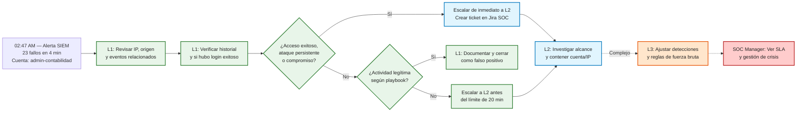
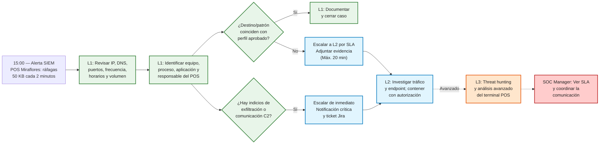

# SOC de Ferretería El Martillo

## Parte 1: Organigrama del SOC

### Contexto del escenario

Ferretería El Martillo cuenta con 30 empleados, tres sucursales en Lima y un servidor en la nube. La gerencia contrató a un proveedor de servicios de seguridad gestionados (MSSP) que brinda un SOC tercerizado de aproximadamente 50 analistas, organizados en tres turnos rotativos de ocho horas para operar 24/7/365.

**Nota sobre la dotación:** Las cantidades indicadas a continuación representan la dotación operativa propuesta por turno para el conjunto de clientes atendidos por el MSSP, no necesariamente personal dedicado exclusivamente a Ferretería El Martillo.

### Nivel L1 - Triage Analyst

* **Cantidad por turno:** 6 analistas L1.
* **Herramientas:** SIEM Microsoft Sentinel y Jira Service Management / Service Desk.
* **Alertas que maneja:** Alertas estandarizadas de alto volumen, como intentos de fuerza bruta, bloqueos automáticos de malware por antivirus/EDR y firmas conocidas de escáneres web, como *User-Agent Fuzzer*.
* **Tiempo máximo antes de escalar:** 20 minutos para alertas no críticas que requieran escalamiento. No es un tiempo de espera obligatorio.
* **Autorización sin escalamiento:** Clasificar y cerrar falsos positivos conocidos únicamente cuando estén explícitamente documentados en los playbooks. Ante indicios de compromiso, debe escalar según el procedimiento de manera inmediata.

### Nivel L2 - Incident Analyst

* **Cantidad por turno:** 2 analistas L2.
* **Herramientas adicionales:** Consolas EDR/XDR (por ejemplo, CrowdStrike, si está disponible en el entorno), sandbox de análisis dinámico (por ejemplo, Any.Run) y herramientas forenses como FTK Imager y Volatility.
* **Casos que recibe:** Alertas complejas que superan los procedimientos estándar, sospechas de persistencia, movimiento lateral o anomalías críticas en el servidor en la nube.
* **Responsabilidades:** Investigar manualmente los equipos afectados, reconstruir la línea de tiempo del ataque, analizar scripts sospechosos en un entorno seguro y ejecutar medidas de contención cuando esté autorizado.

### Nivel L3 - Senior Analyst / Threat Hunter

* **Cantidad propuesta por turno:** 1 analista L3.
* **Responsabilidades especializadas:** Threat hunting proactivo, análisis avanzado de malware, desarrollo de automatizaciones e integraciones SOAR y ajuste de reglas de detección para reducir falsos positivos y fatiga de alertas.
---
### SOC Manager

* **Cantidad propuesta por turno:** 1 responsable operativo.
* **Herramientas:** Jira y paneles de SLA/KPI.
* **Responsabilidades:** Supervisar la cola de incidentes, controlar los SLA, coordinar comunicaciones con la gerencia de Ferretería El Martillo y consolidar métricas. No realiza la investigación técnica directa de primera línea.

### 1.2 Organigrama

```mermaid
flowchart LR
    M["SOC Manager<br/>Supervisión, SLA<br/>y comunicación"] --> L3["L3 — Senior Analyst<br/>Threat hunting y<br/>análisis avanzado"]
    L3 --> L2["L2 — Incident Analyst<br/>Investigación y<br/>contención autorizada"]
    L2 --> L1["L1 — Triage Analyst<br/>Clasificación y<br/>análisis inicial"]
    L1 --> C["Ferretería El Martillo<br/>3 sucursales en Lima<br/>+ Servidor en la nube"]

    L1 -. "Escalamiento" .-> L2
    L2 -. "Complejidad" .-> L3
    L3 -. "Crisis" .-> M

    classDef triage fill:#e8f5e9,stroke:#2e7d32,color:#222,stroke-width:2px;
    classDef incident fill:#e1f5fe,stroke:#0277bd,color:#222,stroke-width:2px;
    classDef senior fill:#ffe6cc,stroke:#e65100,color:#222,stroke-width:2px;
    classDef manager fill:#ffcccc,stroke:#b71c1c,color:#222,stroke-width:2px;
    classDef client fill:#eeeeee,stroke:#616161,color:#222,stroke-width:2px;

    class L1 triage;
    class L2 incident;
    class L3 senior;
    class M manager;
    class C client;
```

------------------------------------------------------------------------

## Parte 2: Flujogramas de escalamiento --- tres escenarios

### 2.1 Procedimientos operativos (playbooks)

Los tiempos que aparecen en cada escenario son estimaciones de trabajo
de L1 si el caso puede resolverse sin escalamiento. El límite de 20
minutos es un máximo para alertas no críticas; los eventos de posible
compromiso se escalan de inmediato. La geolocalización de una IP, por sí
sola, no confirma actividad maliciosa.

### Escenario A: Ráfaga de inicios de sesión fallidos

**Alerta:** A las 02:47 AM, se registran 23 intentos fallidos en un rango de cuatro minutos (ventana temporal de 02:43 AM a 02:47 AM) para la cuenta `admin-contabilidad`, originados desde una dirección IP externa no reconocida (`189.43.xx.xx`).

La investigación en primer nivel debe comprobar si el origen corresponde a una aplicación mal configurada, una tarea programada desactualizada, conexiones VPN legítimas o alguna automatización del cliente. Asimismo, se debe verificar de forma mandatoria si existió un inicio de sesión exitoso posterior a la ráfaga de fallos.

**Tiempo estimado de L1 si no escala:** 7 minutos. Si las validaciones apuntan a un escalamiento, el analista L1 preparará el paquete de datos en Jira en paralelo con las comprobaciones restantes. Está estrictamente prohibido retrasar un escalamiento crítico por intentar completar un análisis estático de segundo orden.

**Evidencia mínima requerida para el ticket:** Cuenta afectada (`admin-contabilidad`), IP de origen (`189.43.xx.xx`), marcas de tiempo exactas del rango de ataque, volumen total de fallos correlacionados, confirmación de existencia/ausencia de eventos de acceso exitoso (`Event ID 4624`), historial de geolocalización de la IP y consultas KQL realizadas en el SIEM.

---
### Escenario B: Proceso sospechoso en el servidor de facturación

**Alerta:** A las 11:15 AM, el SIEM/EDR detecta que el servidor crítico de facturación electrónica ejecutó el binario `cmd.exe`, el cual invocó una instancia oculta de PowerShell con argumentos de evasión y un comando codificado (`powershell -nop -w hidden -encodedCommand <base64>`). Por el contexto del activo afectado y el uso explícito de técnicas de ofuscación, este evento se tipifica como un posible incidente de alta prioridad con riesgo inminente de ejecución de *Ransomware* o establecimiento de persistencia.

Durante la fase de recopilación inicial, el analista L1 **no debe bajo ninguna circunstancia ejecutar el comando ni intentar decodificarlo directamente sobre el servidor productivo**, evitando así la activación accidental de cargas maliciosas secundarias. El escalamiento y notificación hacia el nivel L2 debe ser síncrono al reconocimiento del patrón evasivo, sin demorar la alerta para finalizar la investigación básica.

```mermaid
flowchart LR
    A["11:15 AM — Alerta SIEM/EDR<br/>PowerShell oculto<br/>y comando codificado"] --> B["L1: Registrar host, user,<br/>PID, proceso padre<br/>y comando exacto"]
    B --> C["L1: Consultar telemetría,<br/>hashes, conexiones y<br/>alertas del EDR"]
    C --> D["L1: Evasión sospechosa<br/>reconocida"]
    
    D --> E["Escalar de inmediato a L2<br/>Notificación crítica<br/>y ticket en Jira"]
    E --> F["L2: Preservar evidencia,<br/>investigar alcance,<br/>persistencia y red"]
    
    F --> G{"¿Se confirma<br/>actividad maliciosa<br/>o riesgo activo?"}
    G -- "Sí" --> H["L2: Aplicar aislamiento<br/>de red en EDR y<br/>coordinar con TI"]
    G -- "No" --> I["L2: Continuar análisis<br/>en sandbox; validar<br/>explicación técnica"]
    
    H -. "Avanzado" .-> J["L3: Forense de memoria<br/>RAM y tuning de reglas"]
    I -. "Avanzado" .-> J
    J -.-> K["SOC Manager: Ver SLA<br/>y comunicación de crisis"]

    classDef l1 fill:#e8f5e9,stroke:#2e7d32,color:#222,stroke-width:2px;
    classDef l2 fill:#e1f5fe,stroke:#0277bd,color:#222,stroke-width:2px;
    classDef l3 fill:#ffe6cc,stroke:#e65100,color:#222,stroke-width:2px;
    classDef mgr fill:#ffcccc,stroke:#b71c1c,color:#222,stroke-width:2px;

    class B,C,D l1;
    class E,F,G,H,I l2;
    class J l3;
    class K mgr;
```

**Tiempo estimado de recopilación inicial:** Máximo 5 minutos. El escalamiento hacia L2 debe activarse inmediatamente tras identificar los flags de evasión (`-w hidden` / `-nop`). No existe obligación de agotar los 5 minutos de recopilación si los indicios de compromiso grave son evidentes en los primeros instantes. El analista L1 tiene estrictamente prohibido ejecutar alteraciones en los archivos del servidor.

**Evidencia mínima requerida para el ticket:** Nombre completo del host afectado (Servidor de Facturación), cuenta de usuario que ejecutó la instrucción, identificador del proceso (`PID`), proceso padre (`Parent Process`), línea de comando completa en Base64, marcas de tiempo milimétricas, hash del ejecutable (si está disponible en EDR), telemetría de red asociada y capturas de pantalla de la alerta de la consola.

---

### Escenario C: Tráfico saliente inusual desde el POS de Miraflores

**Alerta:** Desde las 15:00 PM, el SIEM registra que una terminal de punto de venta (POS) ubicada en la sucursal física de Miraflores envía tráfico HTTP anómalo hacia una dirección IP externa no reconocida (`185.220.xx.xx`) geolocalizada en Rusia, bajo un patrón regular de ráfagas de 50 KB exactamente cada dos minutos.

Dado que la geolocalización por sí sola no es suficiente para confirmar un ataque, el analista L1 debe realizar un análisis contextual profundo que involucre la reputación del destino, consultas DNS, puertos utilizados, la aplicación local que genera las conexiones y el inventario del equipo. Asimismo, se debe contrastar el evento contra el catálogo de proveedores aprobados, horarios de mantenimiento programados y el patrón histórico de tráfico de la terminal.

**Tiempo muerto estimado de L1 si no escala:** 9 minutos. Si las verificaciones demuestran que el destino externo no está aprobado o el patrón automatizado carece de justificación de negocio, el analista L1 procesará el escalamiento antes de agotar su ventana operativa de 20 minutos. Ante la confirmación de indicios de exfiltración activa o balizamiento (Beaconing) hacia redes no autorizadas, se ejecutará la política de escalamiento crítico inmediato.

**Evidencia mínima requerida para el ticket:** Direcciones IP y puertos de la sesión de red, registros de consultas DNS inversas, marcas de tiempo detalladas del intervalo de conexiones, métricas de volumen y frecuencia del tráfico, identificador del equipo POS y proceso de origen involucrado, histórico de tráfico del terminal, minutas de validación rápida con el responsable de la sucursal y logs crudos extraídos del firewall perimetral.

------------------------------------------------------------------------

## Parte 3: Cálculo de KPIs — MTTD y MTTR

### 3.1 Calcular MTTD para los 3 escenarios

El **Mean Time To Detect (MTTD)** mide el intervalo de tiempo transcurrido desde el instante en que la actividad anómala o ataque impacta la infraestructura tecnológica hasta que el analista de seguridad confirma el evento mediante la apertura formal de un caso de investigación.

$$\text{MTTD} = \text{Hora de Apertura del Ticket} - \text{Hora de Ocurrencia del Evento}$$

| Escenario | Evento ocurrió | SIEM generó alerta | Analista L1 abrió el ticket | MTTD calculado | ¿Es aceptable para un SOC L1? (Justificación técnica) |
| :--- | :--- | :--- | :--- | :--- | :--- |
| **A (Logins fallidos)** | 02:47:00 | 02:47:42 | 02:52:15 | **5 min 15 seg** | **SÍ.** El SIEM indexa y genera la alerta en 42 segundos. El analista L1 toma 4 minutos y 33 segundos para enriquecer la IP y verificar si hubo accesos exitosos posteriores. Está muy por debajo del límite operativo de 20 minutos. |
| **B (PowerShell)** | 11:15:03 | 11:15:09 | 11:22:40 | **7 min 37 seg** | **SÍ.** Para un servidor de facturación productivo, una ventana menor a 8 minutos para identificar los modificadores de evasión (`-w hidden`), documentar las variables críticas y registrar el caso es altamente eficiente para frenar el despliegue de amenazas. |
| **C (Tráfico outbound)** | 15:00:00 | 15:08:23 | 15:11:05 | **11 min 5 seg** | **SÍ.** El retardo inicial se debe al tiempo de correlación del SIEM (8 min 23 seg) para agrupar las ráfagas consecutivas y validar el umbral (50 KB c/2 min). Una vez generada la alerta, el analista toma solo 2 minutos y 42 segundos en abrir el ticket. |

---

### 3.2 Calcular MTTR estimado

El **Mean Time To Respond / Repair (MTTR)** cuantifica el tiempo total empleado desde que el incidente es detectado e ingresado al sistema hasta que el equipo operativo del SOC ejecuta de manera efectiva la medida de contención o mitigación sobre el activo afectado.

| Escenario | Nivel que cierra | Tiempo estimado de resolución (Justificación de pasos) | MTTR estimado |
| :--- | :--- | :--- | :--- |
| **A (Logins fallidos)** | **Nivel L2** | **15 minutos.** El analista L1 agota 12 minutos en su fase de investigación interna y documentación. Tras la transferencia, el analista L2 toma 3 minutos para aplicar el bloqueo IP en el firewall perimetral y ejecutar el reseteo forzado de la cuenta en Azure AD. | **15 min** |
| **B (PowerShell)** | **Nivel L2 / L3** | **10 minutos.** El analista L1 activa la política de emergencia e interrumpe su análisis a los 5 minutos para escalar el caso. El analista L2 asume de forma síncrona el control del ticket y ejecuta el aislamiento de red remoto (*Network Isolation*) vía CrowdStrike EDR en un lapso de 5 minutos adicionales. | **10 min** |
| **C (Tráfico outbound)** | **Nivel L2** | **15 minutos.** El analista L1 invierte 9 minutos en validar la reputación de la IP rusa y verificar el inventario del POS de Miraflores. Tras recibir el escalamiento, L2 toma 6 minutos en desplegar el bloqueo de red y aislar la VLAN de la caja afectada. | **15 min** |

---

### 3.3 Reflexión sobre los KPIs

El MTTR definitivo del **Escenario B (PowerShell)** suele ser sustancialmente mayor al del **Escenario A (Fuerza Bruta)** en un entorno de producción real porque las ráfagas de logins fallidos se mitigan mediante acciones de contención perimetrales e identitarias directas y estandarizadas (bloqueo de IP de origen y reseteo de la contraseña afectada). 

Por el contrario, la ejecución de código ofuscado dentro de un servidor crítico compromete la integridad del sistema operativo. Aunque la primera acción de contención (aislamiento lógico de la red) se ejecute de manera veloz para mitigar el movimiento lateral, la remediación definitiva exige que los analistas **L2 y L3** extraigan y analicen volcados de la memoria RAM, determinen si se establecieron mecanismos de persistencia o puertas traseras (*Web Shells*), limpien los binarios inyectados y coordinen ventanas de mantenimiento con el cliente para restaurar el servicio de facturación electrónica de forma segura, extendiendo el ciclo de erradicación por varias horas.
