# Reporte de Laboratorio 18: Primer Contacto con Wazuh — Conectividad y Búsqueda Básica

**Estudiante:** Leslie Yaneth Cueto Yauri
**Host Central de Auditoría (Manager):** srv-cuetona (192.168.0.9)

---
 LABORATORIO 18

## Parte 1: Verificar conectividad de agentes en el dashboard

### 1.1 Ingresar al dashboard y explorar la pantalla principal
* **¿Cuántos agentes aparecen en el panel de resumen?**
  Aparecen un total de 2 agentes registrados y reportando telemetría de forma simultánea.
* **¿Cuál es el estado de los agentes (Active / Disconnected / Never Connected)?**
  Ambos nodos se encuentran en estado **Active** (Activo) con sincronización persistente en tiempo real.
* **¿Qué tipo de información muestra el panel principal de eventos? ¿A qué período de tiempo corresponde?**
  Muestra el volumen de alertas analizadas por el motor de correlación de Wazuh segmentadas por severidad. Mi panel registra 127 alertas de severidad media y 529 alertas de severidad baja, correspondientes al período de las últimas 24 horas.

---

### 1.2 Verificar el agente Windows
* **ID del agente:** 002
* **Nombre del host:** win10
* **IP address:** 192.168.0.5
* **Sistema operativo:** Microsoft Windows 10 Pro 10.0.10586.164
* **Versión del agente:** v4.14.9
* **Estado:** Active
* **Última vez que envió eventos:** Sincronizado (En tiempo real)
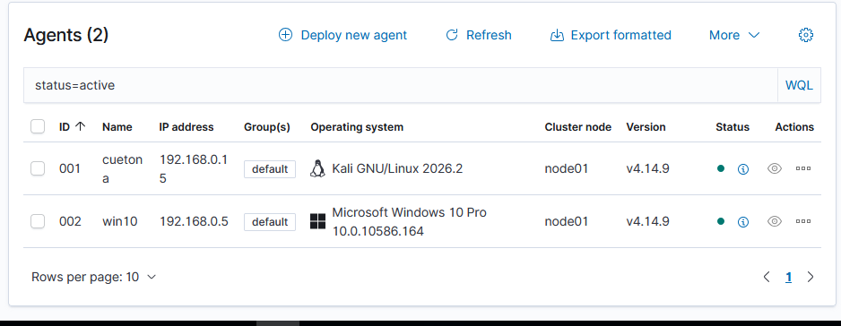 
---

### 1.3 Verificar el agente Ubuntu (Kali Linux Cliente)
* **ID del agente:** 001
* **Nombre del host:** cuetona
* **IP address:** 192.168.0.15
* **Sistema operativo:** Kali GNU/Linux 2026.2
* **Versión del agente:** v4.14.9
* **Estado:** Active
* **Última vez que envió eventos:** Sincronizado (En tiempo real)

---

### 1.4 Verificar conectividad desde el manager (CLI)
Salida oficial recolectada desde la consola central de PuTTY que valida la infraestructura perimetral del negocio:

```text
Wazuh agent_control. List of available agents:
   ID: 000, Name: srv-cuetona (server), IP: 127.0.0.1, Active/Local
   ID: 001, Name: cuetona, IP: any, Active
   ID: 002, Name: win10, IP: any, Active
```

**Evidencia de Verificación:** `evidencias/wazuh-agents-green.png`


 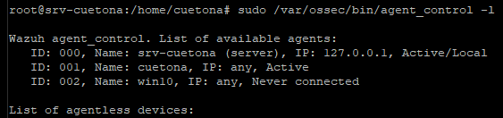 

## Parte 2: Primera búsqueda — Security Events

### 2.1 Navegar a Security Events

Se localizó y accedió al panel de eventos de seguridad mediante el menú lateral izquierdo, siguiendo la ruta:

**Threat intelligence → Threat Hunting → pestaña Events.**

### 2.2 Filtrar por agente Windows

Se aplicó el siguiente filtro para visualizar los eventos correspondientes al agente Windows:

- **Filtro aplicado:** `agent.name: "win10"`

---

### 2.3 Explorar un evento en detalle

Se seleccionó un evento de creación de procesos de Windows.

| Campo | Valor encontrado |
|---|---|
| `rule.id` | 67027 |
| `rule.level` | 3 |
| `rule.description` | A process was created. |
| `agent.name` | win10 |
| `timestamp` | Nov 10, 2026 @ 18:10:10.021 |
| `data.win.system.eventID` | 4688 |

#### Interpretación del evento

- **Proceso creado:** `SearchFilterHost.exe`
- **Proceso padre:** `SearchIndexer.exe`
- **Usuario:** `WIN10$` (cuenta del sistema).
- **Ruta:** `C:\Windows\System32\SearchFilterHost.exe`
- **Canal:** `Security`
- **Resultado:** `AUDIT_SUCCESS`

El proceso `SearchFilterHost.exe` pertenece al servicio de búsqueda e indexación de Windows. Su ejecución es normalmente legítima.

**Conclusión:** Wazuh registró correctamente la creación de un proceso en Windows. La regla tiene nivel 3, por lo que corresponde a un evento de baja severidad y no cumple el requisito de nivel ≥ 5 de la sección 2.4.

---

### 2.4 Identificar un evento con nivel ≥ 5

**Evento seleccionado: Windows application error event**

| Campo | Valor encontrado |
|---|---|
| `rule.id` | 60602 |
| `rule.level` | 9 |
| `rule.description` | Windows application error event. |
| `agent.name` | win10 |
| `timestamp` | Nov 10, 2026 @ 17:45:44.848 |
| `data.win.system.eventID` | 5973 |

#### Análisis del evento

**¿Qué describe `rule.description`?**

Describe un error relacionado con la ejecución o activación de una aplicación de Windows.

**¿Qué evento del sistema generó esta alerta?**

El evento Windows **5973**, registrado en el canal `Application`, indica que no se pudo iniciar la aplicación Microsoft Store (`Microsoft.WindowsStore_8wekyb3d8bbwe!App`) porque no se inició dentro del tiempo requerido.

- **Aplicación:** Microsoft Store.
- **Proveedor:** `Microsoft-Windows-Immersive-Shell`.
- **Severidad registrada por Windows:** `ERROR`.
- **Nivel asignado por Wazuh:** `9`.
- **Código de error:** `-2144927142`.

**¿Considerarías esto como algo para investigar como L1? ¿Por qué?**

Sí. Como analista SOC L1 investigaría el evento porque Wazuh lo clasificó con nivel 9 y Windows registró un error de aplicación. Revisaría si el problema se repite, si afecta a otros usuarios y si existen eventos relacionados en el registro `Microsoft-Windows-TWinUI/Operational`.

Sin embargo, este evento por sí solo no demuestra actividad maliciosa. Podría tratarse de un problema de funcionamiento de Microsoft Store.

#### Evidencia

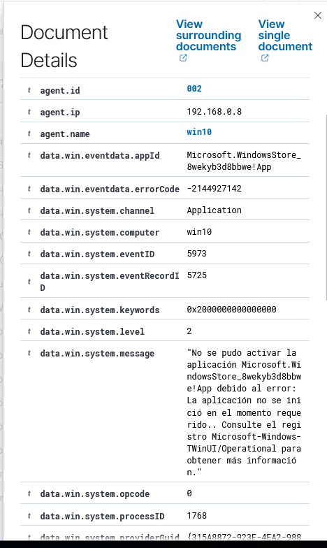
 
## Parte 3: Exploración libre — 3 búsquedas propias

### 3.1 Diseñar tus propias búsquedas

Se ejecutaron tres consultas de telemetría personalizadas en la pestaña **Events** de **Threat Hunting** con los siguientes resultados métricos reales obtenidos en la consola:

| # | Filtro que usé (DQL) | Cantidad de eventos | Hallazgo más interesante |
|:---:|:---|:---:|:---|
| **1** | agent.name: "srv-cuetona" | 326 | Regla 5402: ejecución de sudo para reiniciar Wazuh Dashboard como ROOT. Nivel 3. |
| **2** | `rule.level >= 10` | 25 |Regla 60154, nivel 12: admin.ferre agregó un miembro al grupo local Administradores de Windows..|
| **3** | `	agent.name: "win10" AND rule.level >= 5` | 1,387 |Regla 19005: cumplimiento CIS de Windows 10 de 26 %, con 306 controles fallidos. Nivel 9.|

#### 3.2 Documentar un hallazgo

**Hallazgo: Modificación del grupo local Administradores de Windows.**

Se identificó la regla `60154`, nivel 12, correspondiente al evento de seguridad Windows `4732`, que registra la incorporación de un miembro al grupo local Administradores. La modificación fue realizada por la cuenta `admin.ferre`; el miembro agregado aparece identificado mediante un SID terminado en `1014`.

En Ferretería El Martillo, este cambio podría representar una asignación legítima de privilegios o una modificación no autorizada que aumente el riesgo de acceso administrativo al equipo.

**Acción L1:** Escalaría el evento a L2 para verificar la identidad del SID, la autorización del cambio y su relación con alguna solicitud administrativa. No lo cerraría sin validación.

---
**LABORATORIO 19**

# Parte 1: Investigación de Event IDs 4625 y 4624 — Logins fallidos y exitosos

## 1.1 Filtrar Event ID 4625 (logins fallidos)

**Filtro:** `data.win.system.eventID: 4625`

| Campo | Valor encontrado |
|---|---|
| ¿Cuántos eventos 4625 hay en total? | 38 hits |
| ¿Cuál es la cuenta más intentada? | admin.ferre |
| ¿Cuál es la IP de origen más frecuente? |127.0.0.1|
| ¿En qué período se concentran los intentos? | 05/11/2026, 12:58:20–12:58:23|
| ¿Los intentos son continuos o en ráfagas? | Ráfaga intensa: varios intentos en aproximadamente 3 segundos |

## 1.2 Identificar si es fuerza bruta

**¿El patrón de los 4625 es consistente con un ataque de fuerza bruta? Justifica con los datos de la tabla.**

Sí. Se registraron múltiples fallos de autenticación contra admin.ferre en pocos segundos y Wazuh activó la regla 60204 de nivel 10, correspondiente a múltiples fallos de inicio de sesión.

**¿O podría ser un usuario legítimo que olvidó su contraseña? ¿Qué diferencia ambos escenarios en los logs?**

Un usuario legítimo normalmente genera pocos intentos aislados. Una ráfaga de múltiples contraseñas incorrectas en segundos, que activa una alerta de correlación, es más consistente con fuerza bruta simulada.

## 1.3 Filtrar Event ID 4624 (logins exitosos)

**Filtro:** `data.win.system.eventID: 4624`


| Campo | Valor encontrado |
|---|---|
| ¿Hubo algún login exitoso después de la ráfaga de 4625? | si|
| ¿A qué hora ocurrió el 4624? |09/11/2026 – 14:21:02 |
| ¿Cuántos minutos después del último 4625? |913 minutos aprox. (15 h 13 min) |
| ¿Qué cuenta inició sesión exitosamente? | cuetona |
| ¿Cuál es el Logon Type? | 2 |
| ¿Qué significa ese Logon Type? | Inicio de sesión interactivo local |

## Conclusión

Se identificó un inicio de sesión exitoso (evento 4624, regla 60118, nivel 3) aproximadamente 15 horas y 13 minutos después del último intento fallido observado. La cuenta autenticada fue cuetona, mediante un inicio de sesión interactivo local (Logon Type 2). Este evento confirma una autenticación exitosa posterior, pero no demuestra que la cuenta admin.ferre, objeto de los intentos fallidos, haya sido comprometida.

Hay una diferencia de aproximadamente 5 minutos entre timestamp y systemTime del evento 4624. Para el checkpoint usamos la hora de Wazuh (timestamp), pero conviene documentar esa discrepancia.

---


* **Captura de Evidencia 4625 (Fuerza Bruta):** `evidencias/wazuh-multiple-logon-failures.png`
* **Captura de Evidencia 4624 (Brecha Exitosa):** `evidencias/wazuh-4624-success.png`

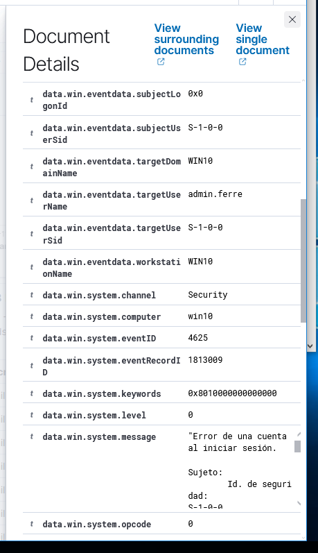

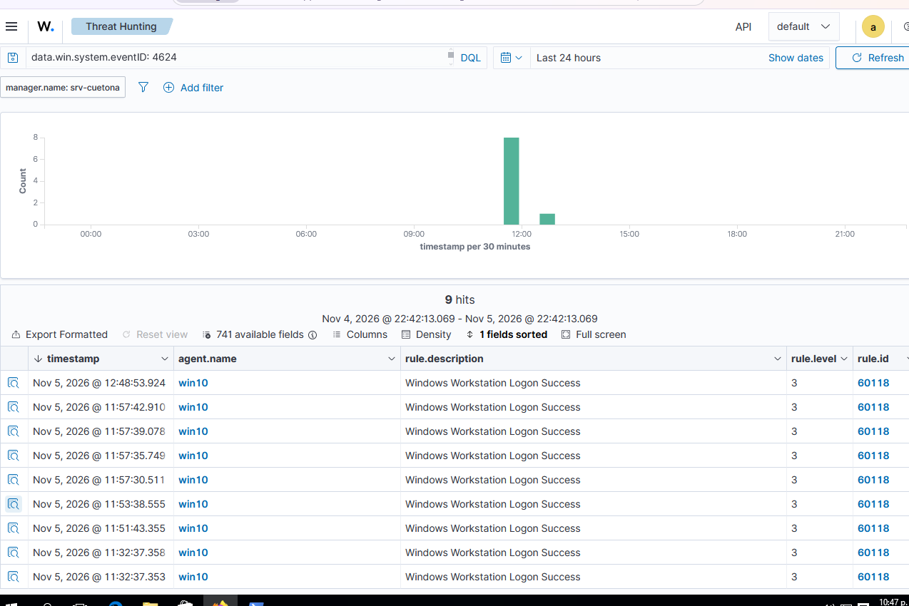


# Parte 2: Investigación de Event IDs 4688 y 4720 — Proceso y cuenta creada

### 2.1 Filtrar Event ID 4688 (proceso creado)

**Filtro:** `data.win.system.eventID: 4688`

| Campo | Evento 1 | Evento 2 |
|---|---|---|
| Nombre del proceso | `cmd.exe` | `cmd.exe` |
| Proceso padre | `cscript.exe` | `runas.exe` |
| Línea de comandos | `cmd.exe /c net use \\127.0.0.1\c$ /user:admin.ferre ClaveInvalida10 2>NUL` | `cmd.exe /c whoami` |
| Hora del evento | 05/11/2026 12:58:23.396 | 05/11/2026 12:48:55.030 |
| ¿Es sospechoso? | Sí. Ejecución automatizada de un intento de acceso al recurso administrativo C$ utilizando credenciales explícitas. | No por sí solo. Es una consulta de identidad ejecutada mediante `runas.exe`. |

**Análisis:** El primer evento presenta mayor interés por el uso de `cscript.exe`, `cmd.exe` y `net use` con credenciales explícitas. El segundo evento corresponde a una consulta de identidad de `lab19.ferre`. La diferencia temporal entre ambos eventos es de aproximadamente 9 minutos y 28 segundos.

### 2.2 Filtrar Event ID 4720 (cuenta creada)

**Filtro utilizado:**
```text
data.win.system.eventID: 4720
```

| Campo | Valor encontrado |
|---|---|
| ¿Se creó alguna cuenta nueva? (sí/no) | Sí, se identificaron dos cuentas nuevas. |
| Si sí: nombre de la cuenta creada | `lab19.ferre` y `soc.prueba`. |
| ¿Quién la creó? (`data.win.eventdata.subjectUserName`) | `admin.ferre`. |
| ¿A qué hora? | `soc.prueba`: 11:13:14.475 y `lab19.ferre`: 11:38:52.707 (05/11/2026). |
| ¿Es coherente con el timeline de los 4625 → 4624? ¿Por qué? | Sí. La cuenta `lab19.ferre` fue creada a las 11:38 y posteriormente presentó intentos fallidos de inicio de sesión alrededor de las 11:53 y un inicio de sesión exitoso a las 12:48. La secuencia temporal es coherente con la creación y posterior utilización de la cuenta, aunque no demuestra por sí sola una relación causal. |

**Análisis:** Ambos eventos tienen la regla Wazuh `60109`, nivel 8, y muestran que las cuentas fueron creadas deshabilitadas y con la opción de no requerir contraseña habilitada. Esta configuración requiere revisión para determinar si la creación de las cuentas fue autorizada.

**Evidencias:** Adjuntar capturas de los dos eventos 4720 encontrados en Wazuh.
### ✅ Checkpoint Parte 2 - Evidencias Forenses Integradas

* **Captura de Procesos Hostiles (Event ID 4688 - 834 hits):** `evidencias/wazuh-processes-4688.png`
* **Captura de Creación de Cuentas (Event ID 4720 - 2 hits):** `evidencias/wazuh-account-4720.png`

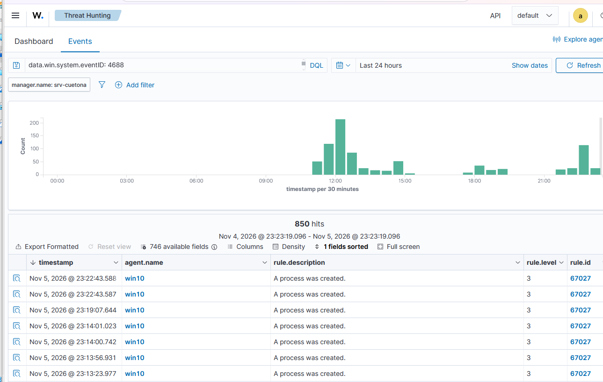

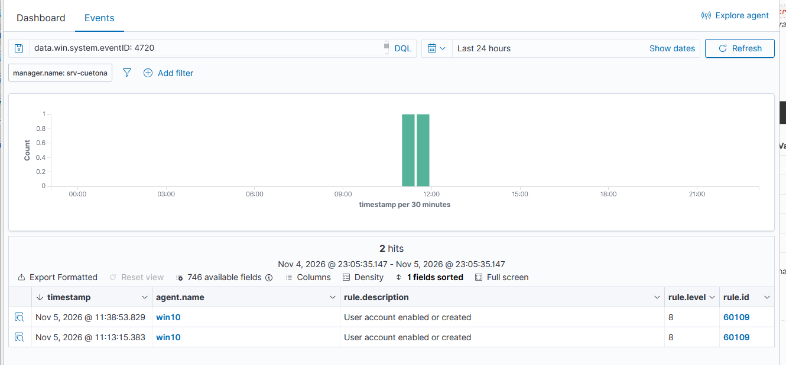

## Parte 3: Informe de Investigación

### 3.1 Construir la línea de tiempo

| Hora (05/11/2026) | Event ID | Descripción del evento | Nivel de sospecha |
|---|---:|---|---|
| 11:13:15.383 | 4720 | `admin.ferre` crea la cuenta `soc.prueba`, deshabilitada y sin requerimiento de contraseña. | Medio |
| 11:38:53.829 | 4720 | `admin.ferre` crea la cuenta `lab19.ferre`, deshabilitada y sin requerimiento de contraseña. | Medio |
| 11:53:10.638 | 4625 | Primer inicio de sesión fallido registrado para `lab19.ferre`, desde `::1`. | Medio |
| 11:53:20.732 | 4625 | Segundo inicio de sesión fallido para `lab19.ferre`, desde `::1`. | Medio |
| 12:48:53.924 | 4624 | Inicio de sesión exitoso de `lab19.ferre`, tipo 2 (interactivo). | Medio |
| 12:48:55.030 | 4688 | `runas.exe` ejecuta `cmd.exe /c whoami` para comprobar la identidad de ejecución. | Bajo |
| 12:58:23.396 | 4688 | `cscript.exe` ejecuta `cmd.exe` con `net use` para acceder a `\\127.0.0.1\c$` usando las credenciales de `admin.ferre`. | Alto |

**Nota:** Los niveles de sospecha son una valoración de investigación basada en el contexto de los eventos, no el nivel numérico de las reglas de Wazuh.

### 3.2 Hipótesis de investigación

**Hipótesis de investigación:**

A partir del análisis del dataset, observé que la cuenta `admin.ferre` creó dos cuentas nuevas: `soc.prueba` y `lab19.ferre`, ambas configuradas como deshabilitadas y sin requerimiento de contraseña.

Los eventos 4625 muestran dos intentos fallidos de inicio de sesión asociados a `lab19.ferre`.

El evento 4624 posterior indica que esta cuenta consiguió iniciar sesión correctamente de forma interactiva.

Los eventos 4688 muestran la ejecución de `whoami` mediante `runas.exe` y, posteriormente, un comando `net use` que intentó acceder al recurso administrativo `C$` utilizando las credenciales de `admin.ferre`.

Mi nivel de confianza en esta hipótesis es **medio**, porque existe una secuencia de eventos que requiere investigación, pero no se ha confirmado que todos formen parte de una misma actividad maliciosa ni que el acceso administrativo haya sido exitoso.

**Recomendación de L1: Escalar a L2** para investigar el uso de las cuentas creadas, validar la actividad de `admin.ferre` y comprobar si hubo acceso no autorizado al recurso administrativo.

----
**LABORATORIO 20**


# LAB 20 – PARTE 1: ANÁLISIS DEL INCIDENTE Y LÍNEA DE TIEMPO

## Parte 1: Análisis del Incidente y Línea de Tiempo

### 1.1 Línea de tiempo del incidente

| # | Hora | Event ID | Descripción | Cuenta / Proceso | Sospecha |
| :--- | :--- | :--- | :--- | :--- | :--- |
| 1 | `10:56:59.713` | `4625` (inicio ráfaga) | Logins fallidos consecutivos (`rule.id: 60122`) | Cuenta: `admin.ferre` (IP: `127.0.0.1`) | Alta |
| 2 | `10:57:13.160` | `4625` (último de ráfaga) | Fin de la ráfaga de fuerza bruta (`rule.id: 60122`, estado `0xC0000234`) | Cuenta: `admin.ferre` (IP: `127.0.0.1`) | Alta |
| 3 | `11:00:04.531` | `4624` | Login exitoso tras múltiples fallos (`rule.id: 100120`, nivel 12) | Cuenta: `admin.ferre` / Logon Type: `3` | Alta |
| 4 | `10:44:00.892` | `4688` | Proceso de reconocimiento ejecutado (`rule.id: 100103`, nivel 8) | Proceso: `whoami.exe`, `net1.exe` | Alta |
| 5 | `11:09:57.949` | `4720` | Cuenta local creada (`rule.id: 60109`, MITRE `T1098`) | Cuenta: `soporte-ti-aprobado` | Media/Alta |

---

### 1.2 Confirmar la hipótesis

* **¿Cuántos eventos 4625 hubo y en qué ventana de tiempo?**
  Hubo **10 eventos 4625** (inicios de sesión fallidos bajo `rule.id: 60122`) contra la cuenta `admin.ferre` desde `127.0.0.1` en una ventana de tiempo de **14 segundos** (desde las `10:56:59.713` hasta las `10:57:13.160`).

* **¿Hubo un 4624 exitoso? ¿A qué hora y con qué Logon Type?**
  **Sí**, se registró un evento **4624** exitoso a las **`11:00:04.531`** sobre la cuenta `admin.ferre` con **Logon Type: 3** (inicio de sesión por red vía NTLM V2) desde la misma dirección IP `127.0.0.1`, disparando la alerta crítica de correlación `100120` (nivel 12).

* **¿Hubo 4688 o 4720 en los minutos siguientes?**
  **Sí**, se detectaron eventos **4688** correspondientes a la ejecución de comandos de reconocimiento (`whoami.exe` y `net1 user`, alerta `100103` nivel 8) bajo la técnica MITRE `T1087`, además del evento **4720** (`rule.id: 60109`) asociado a la creación de cuentas de usuario en el host `win10`.

#### Hipótesis Revisada (para el ticket)

> Se confirma un ataque automatizado de fuerza bruta por red (`Logon Type 3`) dirigido contra la cuenta `admin.ferre` en el equipo `win10` (`192.168.0.8`), compuesto por 10 intentos fallidos (`Event ID 4625`) entre las `10:56:59` y las `10:57:13`, seguidos de un acceso exitoso (`Event ID 4624`) desde la misma IP `127.0.0.1` a las `11:00:04` (alerta crítica `100120`). Posteriormente, se evidenció actividad de reconocimiento interno mediante los procesos `whoami.exe` y `net.exe` (`Event ID 4688`, MITRE `T1087`) y creación de cuenta local (`Event ID 4720`, MITRE `T1098`).

### Evidencias individuales del incidente

**1. Inicio de ráfaga de intentos fallidos (`Event ID 4625`)**
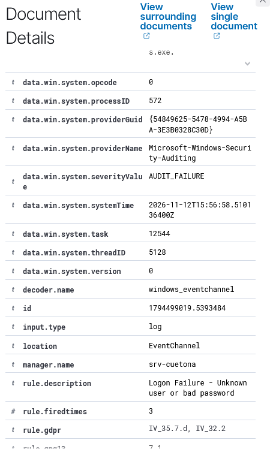

**2. Cierre de ráfaga / Alerta de fuerza bruta (`Event ID 4625` / `60204`)**
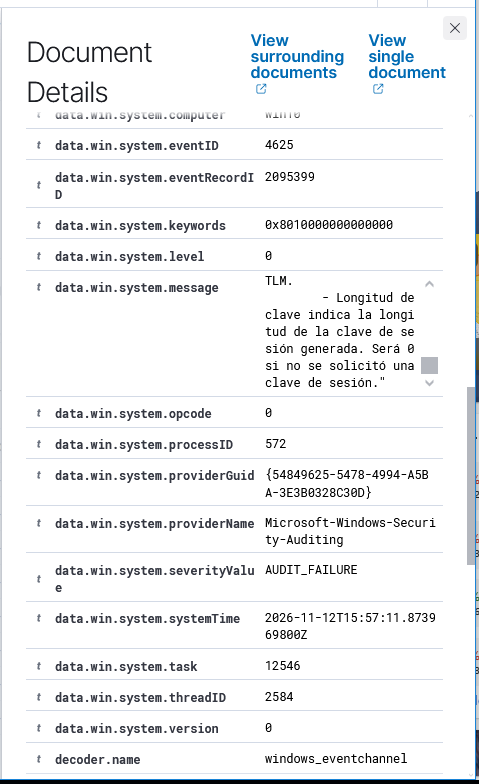

**3. Inicio de sesión exitoso tras fuerza bruta (`Event ID 4624` / `100120`)**
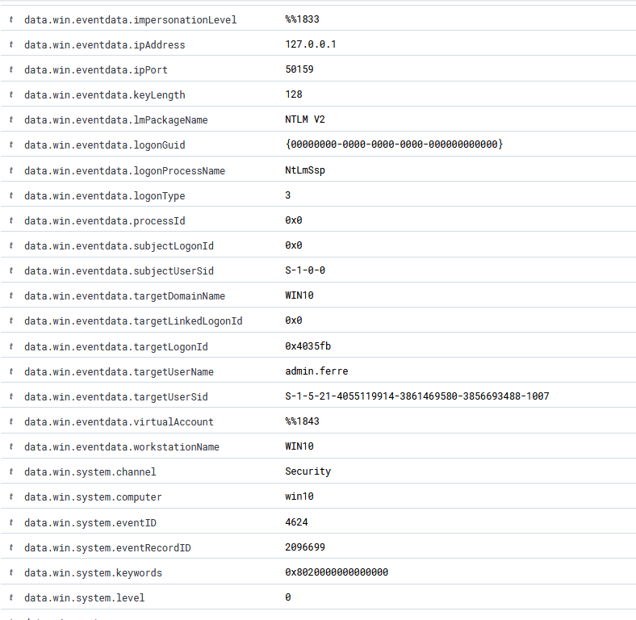

**4. Ejecución de procesos de reconocimiento (`Event ID 4688` / `100103`)**
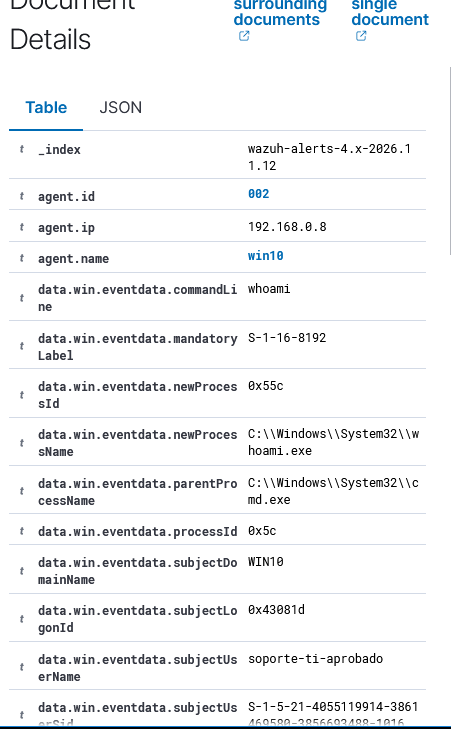

**5. Creación de cuenta de usuario (`Event ID 4720`)**
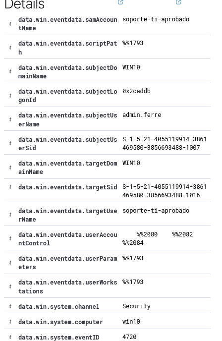
