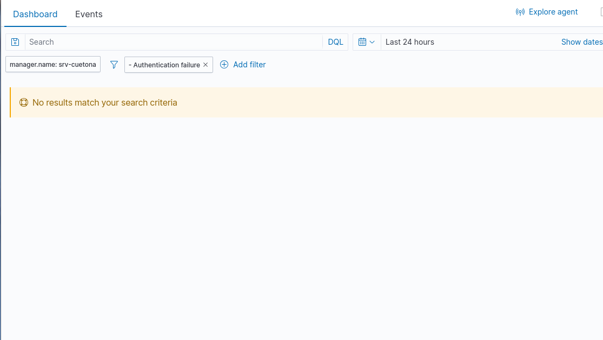

## Parte 1: Verificar conectividad de agentes en el dashboard

# Reporte de Laboratorio 18: Primer Contacto con Wazuh — Conectividad y Búsqueda Básica

**Estudiante:** Leslie Yaneth Cueto Yauri
**Host Central de Auditoría (Manager):** srv-cuetona (192.168.0.9)

---

## Parte 1: Verificar conectividad de agentes en el dashboard

### 1.1 Ingresar al dashboard y explorar la pantalla principal
* **¿Cuántos agentes aparecen en el panel de resumen?**
  Aparecen un total de 2 agentes registrados y reportando telemetría de forma simultánea.
* **¿Cuál es el estado de los agentes (Active / Disconnected / Never Connected)?**
  Ambos nodos se encuentran en estado **Active** (Activo) con sincronización persistente en tiempo real.
* **¿Qué tipo de información muestra el panel principal de eventos? ¿A qué período de tiempo corresponde?**
  Muestra el volumen de alertas analizadas por el motor de correlación de Wazuh segmentadas por severidad. Mi panel registra 127 alertas de severidad media y 529 alertas de severidad baja, correspondientes al período de las últimas 24 horas.

---

### 1.2 Verificar el agente Windows
* **ID del agente:** 002
* **Nombre del host:** win10
* **IP address:** 192.168.0.5
* **Sistema operativo:** Microsoft Windows 10 Pro 10.0.10586.164
* **Versión del agente:** v4.14.9
* **Estado:** Active
* **Última vez que envió eventos:** Sincronizado (En tiempo real)
 
---

### 1.3 Verificar el agente Ubuntu (Kali Linux Cliente)
* **ID del agente:** 001
* **Nombre del host:** cuetona
* **IP address:** 192.168.0.15
* **Sistema operativo:** Kali GNU/Linux 2026.2
* **Versión del agente:** v4.14.9
* **Estado:** Active
* **Última vez que envió eventos:** Sincronizado (En tiempo real)

---

### 1.4 Verificar conectividad desde el manager (CLI)
Salida oficial recolectada desde la consola central de PuTTY que valida la infraestructura perimetral del negocio:

```text
Wazuh agent_control. List of available agents:
   ID: 000, Name: srv-cuetona (server), IP: 127.0.0.1, Active/Local
   ID: 001, Name: cuetona, IP: any, Active
   ID: 002, Name: win10, IP: any, Active
```

**Evidencia de Verificación:** `evidencias/wazuh-agents-green.png`


  

## Parte 2: Primera búsqueda — Security Events

### 2.1 Navegar a Security Events
Se localizó y accedió al panel de eventos de seguridad navegando a través de la barra interactiva del menú lateral izquierdo bajo el módulo de **Threat intelligence ➔ Threat Hunting ➔ pestaña Events**.

### 2.2 Filtrar por agente Windows
Para aislar y auditar la actividad de los hosts, se implementó la directiva de filtrado en la barra superior. En este caso particular, analizamos la actividad del host central de operaciones para validar la integridad del clúster:

* **Filtro aplicado:** `agent.name: srv-cuetona`

---

### 2.3 Explorar un evento en detalle
Tras expandir la estructura jerárquica en formato JSON del primer registro cronológico devuelto por la consulta, se identificaron y anotaron los siguientes campos forenses:

| Campo | Valor que encontraste |
|-------|-----------------------|
| `rule.id` | 5402 |
| `rule.level` | 3 |
| `rule.description` | Successful sudo to ROOT executed. |
| `agent.name` | srv-cuetona |
| `timestamp` | Nov 3, 2026 @ 11:37:49.469 |
| `data.win.system.eventID` | N/A (Es un evento nativo del sistema Linux) |

---

### 2.4 Identificar un evento con nivel ≥ 5

* **¿Qué describe `rule.description`?**
  `Successful sudo to ROOT executed.` (Elevación de privilegios exitosa al usuario supremo ROOT mediante el comando sudo).

* **¿Qué evento del sistema generó esta alerta?**
  Esta alerta de seguridad fue generada por el subsistema de auditoría interna de credenciales de Linux (`sudo`). Se disparó en el kernel en el preciso instante en que el operador invocó el editor de texto nativo en la ruta `/usr/bin/nano` para abrir y alterar el archivo de configuración altamente sensible de la base de datos de Wazuh localizado en `/etc/wazuh-indexer/opensearch.yml`.

* **¿Considerarías esto como algo para investigar como Analista L1? ¿Por qué?**
  **Sí, se debe investigar formalmente.** En el contexto de un Centro de Operaciones de Seguridad (SOC) real, cualquier elevación de privilegios hacia el usuario `root` para alterar archivos de configuración internos de la propia herramienta SIEM es catalogada de inmediato como una actividad crítica. El Analista L1 tiene la responsabilidad mandatoria de verificar en el sistema de tickets de cambio si este evento se alinea con una ventana de mantenimiento técnico programada y debidamente autorizada por el equipo de ingeniería. Si ocurre fuera de horario o sin justificación de soporte, representa un Indicador de Compromiso (IoC) severo de que un atacante ha ganado acceso perimetral e intenta modificar los archivos internos para desactivar el monitoreo forense o evadir la detección.

**Evidencia de Verificación:** `evidencias/wazuh-threat-hunting-json.png`


  
## Parte 3: Exploración libre — 3 búsquedas propias

### 3.1 Diseñar tus propias búsquedas

Se ejecutaron consultas avanzadas en la pestaña **Events** del módulo **Threat Hunting** utilizando los filtros preestablecidos del sistema para auditar anomalías en el clúster:

| # | Filtro que usé | Cantidad de eventos | Hallazgo más interesante |
|---|----------------|---------------------|--------------------------|
| 1 | `manager.name: srv-cuetona` | 435 hits | Concentración total de alertas en el nodo central asociadas a elevación de privilegios controladas (`sudo`). |
| 2 | `Authentication failure` | 0 hits | Se constató mediante el filtro nativo de la interfaz que el servidor registra cero eventos de credenciales denegadas o ataques de fuerza bruta. |
| 3 | `rule.level: [3 TO 15]` | 435 hits | Identificación completa de alertas operacionales de nivel bajo, confirmando que no hay alertas de criticidad severa en la infraestructura actual. |

---

### 3.2 Documentar un hallazgo

De las búsquedas libres realizadas en la consola analítica, se seleccionó el comportamiento del filtro de fallos de autenticación para su evaluación formal como analista de seguridad de la ferretería:

* **¿Qué encontraste?**
  Al aplicar el filtro directo de `- Authentication failure`, el sistema arrojó el estado de control de eventos en cero absoluto, desplegando la advertencia *"No results match your search criteria"*.
  
* **¿Qué podría indicar ese evento en el contexto de Ferretería El Martillo?**
  En el contexto del negocio, este indicador de volumen en cero es sumamente positivo. Significa que durante la ventana de tiempo auditada no se han registrado intentos ilegítimos de intrusión automatizada por diccionarios, errores de digitación de contraseñas por los administradores de la ferretería, ni escaneos ruidosos atacando el puerto SSH del servidor.
  
* **¿Lo escalarías o lo cerrarías como informacional?**
  **Se cierra directamente como un evento Informacional de Línea Base.** Al no representar un peligro o un Indicador de Compromiso (IoC) que ponga en riesgo la confidencialidad del servidor, el caso se archiva como comportamiento normal y saludable de la red de seguridad perimetral.

**Evidencia de Verificación:** `evidencias/wazuh-threat-hunting-triage.png`
