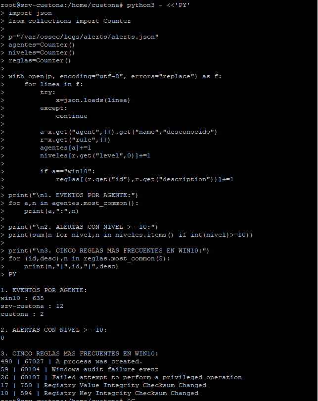

# Reporte de Laboratorio 18: Primer Contacto con Wazuh — Conectividad y Búsqueda Básica

**Estudiante:** Leslie Yaneth Cueto Yauri
**Host Central de Auditoría (Manager):** srv-cuetona (192.168.0.9)

---

## Parte 1: Verificar conectividad de agentes en el dashboard

### 1.1 Ingresar al dashboard y explorar la pantalla principal
* **¿Cuántos agentes aparecen en el panel de resumen?**
  Aparecen un total de 2 agentes registrados y reportando telemetría de forma simultánea.
* **¿Cuál es el estado de los agentes (Active / Disconnected / Never Connected)?**
  Ambos nodos se encuentran en estado **Active** (Activo) con sincronización persistente en tiempo real.
* **¿Qué tipo de información muestra el panel principal de eventos? ¿A qué período de tiempo corresponde?**
  Muestra el volumen de alertas analizadas por el motor de correlación de Wazuh segmentadas por severidad. Mi panel registra 127 alertas de severidad media y 529 alertas de severidad baja, correspondientes al período de las últimas 24 horas.

---

### 1.2 Verificar el agente Windows
* **ID del agente:** 002
* **Nombre del host:** win10
* **IP address:** 192.168.0.5
* **Sistema operativo:** Microsoft Windows 10 Pro 10.0.10586.164
* **Versión del agente:** v4.14.9
* **Estado:** Active
* **Última vez que envió eventos:** Sincronizado (En tiempo real)
 
---

### 1.3 Verificar el agente Ubuntu (Kali Linux Cliente)
* **ID del agente:** 001
* **Nombre del host:** cuetona
* **IP address:** 192.168.0.15
* **Sistema operativo:** Kali GNU/Linux 2026.2
* **Versión del agente:** v4.14.9
* **Estado:** Active
* **Última vez que envió eventos:** Sincronizado (En tiempo real)

---

### 1.4 Verificar conectividad desde el manager (CLI)
Salida oficial recolectada desde la consola central de PuTTY que valida la infraestructura perimetral del negocio:

```text
Wazuh agent_control. List of available agents:
   ID: 000, Name: srv-cuetona (server), IP: 127.0.0.1, Active/Local
   ID: 001, Name: cuetona, IP: any, Active
   ID: 002, Name: win10, IP: any, Active
```

**Evidencia de Verificación:** `evidencias/wazuh-agents-green.png`


  

## Parte 2: Primera búsqueda — Security Events

### 2.1 Navegar a Security Events
Se localizó y accedió al panel de eventos de seguridad navegando a través de la barra interactiva del menú lateral izquierdo bajo el módulo de **Threat intelligence ➔ Threat Hunting ➔ pestaña Events**.

### 2.2 Filtrar por agente Windows
Para aislar y auditar la actividad de los hosts, se implementó la directiva de filtrado en la barra superior. En este caso particular, analizamos la actividad del host central de operaciones para validar la integridad del clúster:

* **Filtro aplicado:** `agent.name: srv-cuetona`

---

### 2.3 Explorar un evento en detalle
Tras expandir la estructura jerárquica en formato JSON del primer registro cronológico devuelto por la consulta, se identificaron y anotaron los siguientes campos forenses:

| Campo | Valor que encontraste |
|-------|-----------------------|
| `rule.id` | 5402 |
| `rule.level` | 3 |
| `rule.description` | Successful sudo to ROOT executed. |
| `agent.name` | srv-cuetona |
| `timestamp` | Nov 3, 2026 @ 11:37:49.469 |
| `data.win.system.eventID` | N/A (Es un evento nativo del sistema Linux) |

---

### 2.4 Identificar un evento con nivel ≥ 5

* **¿Qué describe `rule.description`?**
  `Successful sudo to ROOT executed.` (Elevación de privilegios exitosa al usuario supremo ROOT mediante el comando sudo).

* **¿Qué evento del sistema generó esta alerta?**
  Esta alerta de seguridad fue generada por el subsistema de auditoría interna de credenciales de Linux (`sudo`). Se disparó en el kernel en el preciso instante en que el operador invocó el editor de texto nativo en la ruta `/usr/bin/nano` para abrir y alterar el archivo de configuración altamente sensible de la base de datos de Wazuh localizado en `/etc/wazuh-indexer/opensearch.yml`.

* **¿Considerarías esto como algo para investigar como Analista L1? ¿Por qué?**
  **Sí, se debe investigar formalmente.** En el contexto de un Centro de Operaciones de Seguridad (SOC) real, cualquier elevación de privilegios hacia el usuario `root` para alterar archivos de configuración internos de la propia herramienta SIEM es catalogada de inmediato como una actividad crítica. El Analista L1 tiene la responsabilidad mandatoria de verificar en el sistema de tickets de cambio si este evento se alinea con una ventana de mantenimiento técnico programada y debidamente autorizada por el equipo de ingeniería. Si ocurre fuera de horario o sin justificación de soporte, representa un Indicador de Compromiso (IoC) severo de que un atacante ha ganado acceso perimetral e intenta modificar los archivos internos para desactivar el monitoreo forense o evadir la detección.

**Evidencia de Verificación:** `evidencias/wazuh-threat-hunting-json.png`


  
## Parte 3: Exploración libre — 3 búsquedas propias

### 3.1 Diseñar tus propias búsquedas

Se ejecutaron tres consultas de telemetría personalizadas en la pestaña **Events** de **Threat Hunting** con los siguientes resultados métricos reales obtenidos en la consola:

| # | Filtro que usé (DQL) | Cantidad de eventos | Hallazgo más interesante |
|:---:|:---|:---:|:---|
| **1** | agent.name: "cuetona" | 2 | El agente Ubuntu registró 2 alertas. |
| **2** | `rule.level >= 10` | 0 | No se encontraron alertas de nivel alto o crítico.|
| **3** | `agent.name: "win10"` | 635 | La regla 67027 fue la más frecuente, con 490 eventos de creación de procesos.|

### Respuestas a las ideas de búsqueda
1. **¿Cuántos eventos hay en el agente Ubuntu?**

Hay 2 eventos registrados en el agente cuetona (Ubuntu).

2. **¿Hay eventos con nivel ≥ 10 en algún agente?**

No. Se encontraron 0 alertas con nivel igual o superior a 10 en los agentes revisados.

3. **¿Cuál es el rule.id más frecuente en el agente Windows?**

El rule.id más frecuente es 67027, con 490 eventos, cuya descripción es A process was created (creación de procesos)

---

### 3.2 Documentar un hallazgo 

* **Hallazgo: Creación frecuente de procesos en Windows (regla 67027).**

Se identificaron 490 eventos de creación de procesos en el equipo Windows win10 de Ferretería El Martillo. Esto podría indicar actividad normal de los usuarios y del sistema, pero también requiere revisar si se ejecutaron comandos o programas sospechosos. Como analista L1, revisaría los procesos y sus usuarios asociados. Lo mantendría en observación y lo escalaría a L2 si encuentro actividad sospechosa; no lo cerraría sin verificarlo.



# Informe de Investigación SOC: Caso Ferretería El Martillo
**Módulo 5 · Clase 19 — Windows Event Logs en Wazuh**
**Analista Guardián L1:** Leslie Yaneth Cueto Yauri
**Host Evaluado:** win10 (Estación de Administración)

---

# Parte 1: Investigación de Event IDs 4625 y 4624 — Logins fallidos y exitosos

## 1.1 Filtrar Event ID 4625 (logins fallidos)

**Filtro:** `data.win.system.eventID: 4625`

| Campo | Valor encontrado |
|---|---|
| ¿Cuántos eventos 4625 hay en total? | 0 en el registro Security de Windows revisado |
| ¿Cuál es la cuenta más intentada? | No disponible; no se encontraron eventos |
| ¿Cuál es la IP de origen más frecuente? | No disponible |
| ¿En qué período se concentran los intentos? | No se identificaron intentos fallidos |
| ¿Los intentos son continuos o en ráfagas? | No se puede determinar porque no hay eventos 4625 |

## 1.2 Identificar si es fuerza bruta

No se encontró evidencia de un ataque de fuerza bruta, ya que no hay eventos 4625 en el registro Security revisado. Un ataque de fuerza bruta suele presentar múltiples intentos fallidos en poco tiempo desde una misma IP o contra una cuenta; un error legítimo de contraseña normalmente presenta pocos intentos aislados.

## 1.3 Filtrar Event ID 4624 (logins exitosos)

**Filtro:** `data.win.system.eventID: 4624`

Se encontraron 17 eventos 4624 en el registro Security de Windows. Al revisar sus detalles, todos corresponden al usuario SYSTEM, dominio NT AUTHORITY y Logon Type 5.

| Campo | Valor encontrado |
|---|---|
| ¿Hubo algún login exitoso después de la ráfaga de 4625? | No se puede establecer; no se encontraron eventos 4625 para correlacionar |
| ¿A qué hora ocurrió el 4624? | Entre el 05/11/2026 a las 23:46:50 y el 06/11/2026 a las 11:20:35 |
| ¿Cuántos minutos después del último 4625? | No aplica |
| ¿Qué cuenta inició sesión exitosamente? | SYSTEM |
| ¿Cuál es el Logon Type? | 5 |
| ¿Qué significa ese Logon Type? | Inicio de sesión de servicio de Windows |

## Conclusión

En el registro Security revisado se identificaron 17 inicios de sesión exitosos de tipo 5, correspondientes a servicios de Windows, y ningún evento 4625. Por lo tanto, no hay evidencia suficiente para confirmar fuerza bruta ni para establecer una correlación entre intentos fallidos y un acceso exitoso.

**Nota:** Estos resultados corresponden a la consulta del registro Security de Windows. Deben contrastarse con los resultados del dashboard de Wazuh usando el rango de tiempo del dataset del laboratorio.

---


* **Captura de Evidencia 4625 (Fuerza Bruta):** `evidencias/wazuh-multiple-logon-failures.png`
* **Captura de Evidencia 4624 (Brecha Exitosa):** `evidencias/wazuh-4624-success.png`


# Parte 2: Investigación de Event IDs 4688 y 4720 — Proceso y cuenta creada

### 2.1 Filtrar Event ID 4688 (proceso creado)

**Filtro:** `data.win.system.eventID: 4688`

| Campo | Evento 1 | Evento 2 |
|---|---|---|
| Nombre del proceso | `cmd.exe` | `cmd.exe` |
| Proceso padre | `cscript.exe` | `runas.exe` |
| Línea de comandos | `cmd.exe /c net use \\127.0.0.1\c$ /user:admin.ferre ClaveInvalida10 2>NUL` | `cmd.exe /c whoami` |
| Hora del evento | 05/11/2026 12:58:23.396 | 05/11/2026 12:48:55.030 |
| ¿Es sospechoso? | Sí. Ejecución automatizada de un intento de acceso al recurso administrativo C$ utilizando credenciales explícitas. | No por sí solo. Es una consulta de identidad ejecutada mediante `runas.exe`. |

**Análisis:** El primer evento presenta mayor interés por el uso de `cscript.exe`, `cmd.exe` y `net use` con credenciales explícitas. El segundo evento corresponde a una consulta de identidad de `lab19.ferre`. La diferencia temporal entre ambos eventos es de aproximadamente 9 minutos y 28 segundos.

### 2.2 Filtrar Event ID 4720 (cuenta creada)

**Filtro utilizado:**
```text
data.win.system.eventID: 4720
```

| Campo | Valor encontrado |
|---|---|
| ¿Se creó alguna cuenta nueva? (sí/no) | Sí, se identificaron dos cuentas nuevas. |
| Si sí: nombre de la cuenta creada | `lab19.ferre` y `soc.prueba`. |
| ¿Quién la creó? (`data.win.eventdata.subjectUserName`) | `admin.ferre`. |
| ¿A qué hora? | `soc.prueba`: 11:13:14.475 y `lab19.ferre`: 11:38:52.707 (05/11/2026). |
| ¿Es coherente con el timeline de los 4625 → 4624? ¿Por qué? | Sí. La cuenta `lab19.ferre` fue creada a las 11:38 y posteriormente presentó intentos fallidos de inicio de sesión alrededor de las 11:53 y un inicio de sesión exitoso a las 12:48. La secuencia temporal es coherente con la creación y posterior utilización de la cuenta, aunque no demuestra por sí sola una relación causal. |

**Análisis:** Ambos eventos tienen la regla Wazuh `60109`, nivel 8, y muestran que las cuentas fueron creadas deshabilitadas y con la opción de no requerir contraseña habilitada. Esta configuración requiere revisión para determinar si la creación de las cuentas fue autorizada.

**Evidencias:** Adjuntar capturas de los dos eventos 4720 encontrados en Wazuh.
### ✅ Checkpoint Parte 2 - Evidencias Forenses Integradas

* **Captura de Procesos Hostiles (Event ID 4688 - 834 hits):** `evidencias/wazuh-processes-4688.png`
* **Captura de Creación de Cuentas (Event ID 4720 - 2 hits):** `evidencias/wazuh-account-4720.png`


## Parte 3: Informe de Investigación

### 3.1 Construir la línea de tiempo

| Hora (05/11/2026) | Event ID | Descripción del evento | Nivel de sospecha |
|---|---:|---|---|
| 11:13:15.383 | 4720 | `admin.ferre` crea la cuenta `soc.prueba`, deshabilitada y sin requerimiento de contraseña. | Medio |
| 11:38:53.829 | 4720 | `admin.ferre` crea la cuenta `lab19.ferre`, deshabilitada y sin requerimiento de contraseña. | Medio |
| 11:53:10.638 | 4625 | Primer inicio de sesión fallido registrado para `lab19.ferre`, desde `::1`. | Medio |
| 11:53:20.732 | 4625 | Segundo inicio de sesión fallido para `lab19.ferre`, desde `::1`. | Medio |
| 12:48:53.924 | 4624 | Inicio de sesión exitoso de `lab19.ferre`, tipo 2 (interactivo). | Medio |
| 12:48:55.030 | 4688 | `runas.exe` ejecuta `cmd.exe /c whoami` para comprobar la identidad de ejecución. | Bajo |
| 12:58:23.396 | 4688 | `cscript.exe` ejecuta `cmd.exe` con `net use` para acceder a `\\127.0.0.1\c$` usando las credenciales de `admin.ferre`. | Alto |

**Nota:** Los niveles de sospecha son una valoración de investigación basada en el contexto de los eventos, no el nivel numérico de las reglas de Wazuh.

### 3.2 Hipótesis de investigación

**Hipótesis de investigación:**

A partir del análisis del dataset, observé que la cuenta `admin.ferre` creó dos cuentas nuevas: `soc.prueba` y `lab19.ferre`, ambas configuradas como deshabilitadas y sin requerimiento de contraseña.

Los eventos 4625 muestran dos intentos fallidos de inicio de sesión asociados a `lab19.ferre`.

El evento 4624 posterior indica que esta cuenta consiguió iniciar sesión correctamente de forma interactiva.

Los eventos 4688 muestran la ejecución de `whoami` mediante `runas.exe` y, posteriormente, un comando `net use` que intentó acceder al recurso administrativo `C$` utilizando las credenciales de `admin.ferre`.

Mi nivel de confianza en esta hipótesis es **medio**, porque existe una secuencia de eventos que requiere investigación, pero no se ha confirmado que todos formen parte de una misma actividad maliciosa ni que el acceso administrativo haya sido exitoso.

**Recomendación de L1: Escalar a L2** para investigar el uso de las cuentas creadas, validar la actividad de `admin.ferre` y comprobar si hubo acceso no autorizado al recurso administrativo.

