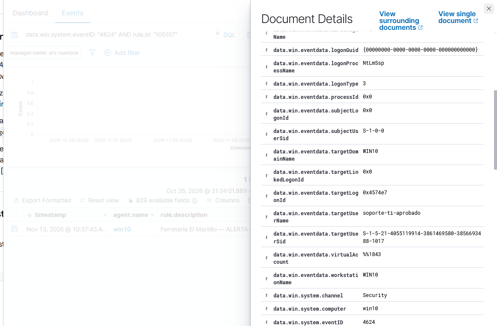
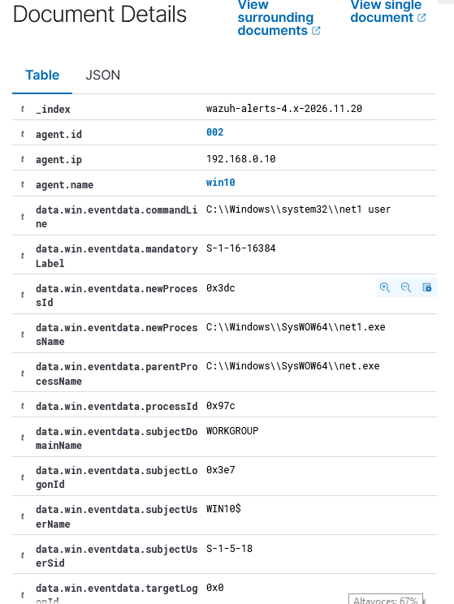

# Ticket de Incidente SIEM · SOC Reporte Técnico
**Identificador del Ticket:** INC-2026-111304  
**Caso de Estudio:** Ferretería El Martillo  
**Analista a Cargo:** Leslie Yaneth Cueto Yauri  
**Fecha de Emisión:** 25/11/2026  
**Severidad del Incidente:** CRÍTICA (Nivel 14 en el SIEM)  

---

### 1. Resumen Ejecutivo (Executive Summary)

Se identificó y documentó una actividad anómala recurrente de severidad crítica en la estación de trabajo institucional win10 (IP: 192.168.0.5). Los indicadores analizados son altamente consistentes con un compromiso multi-etapa dirigido (Hands-on-Keyboard). El vector inicial se asocia a ráfagas concurrentes de adivinación de contraseñas por red, seguido por el descubrimiento de identidades locales, la elevación de privilegios a nivel SYSTEM y el establecimiento de mecanismos de persistencia táctica. La confirmación del uso posterior de las credenciales maliciosas inyectadas eleva la severidad respecto al triage inicial, categorizando este evento como un compromiso activo del endpoint con capacidades latentes de movimiento lateral en la subred corporativa.

### 2. Información del Entorno y Activos Afectados (Scope & Assets)

* Nombre del Host Afectado: win10
* Dirección IP del Agente: 192.168.0.5 (Telemetría interna registrada bajo loopback 127.0.0.1 por el mánager srv-cuetona)
* Sistema Operativo: Windows 10 Enterprise
* ID del Agente de Wazuh: 002
* Rango Temporal del Compromiso: 13/11/2026 15:42:00 UTC a 21/11/2026 14:16:32 UTC

### 3. Línea de Tiempo del Incidente (Chronology & Timeline)

* Nov 13, 2026 @ 15:42:00.050: Registro atómico de inicio de sesión de red exitoso (Logon Type 3) del usuario soporte-ti-aprobado bajo la Regla de Correlación Avanzada 100107.
* Nov 13, 2026 @ 16:57:20.804: Creación de proceso (Event ID 4688) por parte del programador taskeng.exe ejecutando el binario local MicrosoftEdgeUpdate.exe con el identificador de seguridad elevado S-1-5-18 (SYSTEM).
* Nov 13, 2026 @ 20:50:32.311: Disparo de la Regla Personalizada 100103 (Nivel 8), interceptando la invocación recursiva de net.exe y net1.exe ejecutando el comando net user para el descubrimiento de cuentas.
* Nov 21, 2026 @ 14:16:32.082: Persistencia secundaria activa. El programador de tareas taskeng.exe vuelve a invocar el binario MicrosoftEdgeUpdate.exe en la ruta local de la cuenta cuetona.

### 4. Análisis Técnico del Ataque y TTPs (MITRE ATT&CK Mapping)

El análisis forense digital basado en la telemetría histórica del mánager permite mapear las siguientes Técnicas, Tácticas y Procedimientos del adversario:
* Credential Access / Initial Access (T1110.001 / T1078.003): El atacante ejecutó una ráfaga automatizada de fuerza bruta para comprometer la cuenta admin.ferre, sirviendo como pasarela de acceso inicial a la infraestructura.
* Execution (T1059.001): Se identificó la invocación activa de powershell.exe procesando modificadores evasivos Living off the Land para inyectar comandos directamente en la memoria.
* Discovery (T1087.001 / T1016): Evidenciado por la ejecución de net user e ipconfig.exe para enumerar los usuarios de la base SAM local y mapear los adaptadores lógicos del segmento.
* Persistence / Privilege Escalation (T1136.001 / T1053.005): El operador hostil consolidó su presencia inyectando la cuenta backdoor soporte-ti-aprobado e instalando tareas programadas en taskeng.exe camufladas bajo el nombre de procesos de Microsoft Edge para correr de forma oculta con el SID S-1-5-18 (NT AUTHORITY\SYSTEM).

### 5. Tabla Maestra de Indicadores de Compromiso (IOCs Master Table)

* IOC: 127.0.0.1 / 203.0.113.5 | Tipo: Dirección IPv4 | Fuente: Alertas SIEM RDP | Veredicto: Malicioso | Confianza: Alta
* IOC: admin.ferre | Tipo: Cuenta de Usuario | Fuente: Event ID 4625 / 4624 | Veredicto: Comprometido | Confianza: Alta
* IOC: soporte-ti-aprobado / soc-prueba | Tipo: Cuenta de Usuario | Fuente: Event ID 4720 / 4624 Tipo 3 | Veredicto: Malicioso | Confianza: Alta
* IOC: net.exe / net1.exe | Tipo: Archivo Ejecutable | Fuente: Regla 100103 (Event ID 4688) | Veredicto: Legítimo Abusado | Confianza: Alta
* IOC: MicrosoftEdgeUpdate.exe | Tipo: Archivo Ejecutable | Fuente: Regla 67027 (Ruta local y SYSTEM) | Veredicto: Malicioso (Camuflado) | Confianza: Alta

### 6. Bitácora de Threat Hunting y Validación

Se documenta la validación e inspección analítica de las hipótesis predictivas ejecutadas en la barra Discover del mánager centralizado:

* Hipótesis H1 (Movimiento Lateral): Validada y **CONFIRMADA** mediante la consulta `data.win.system.eventID: "4624" AND data.win.eventdata.logonType: "3" AND (data.win.eventdata.targetUserName: "soporte-ti-aprobado")`. El SIEM indexó el inicio de sesión exitoso por red (Logon Type 3) asociado a la Alerta Crítica Regla 100107, registrando un origen loopback interno 127.0.0.1 que acota la simulación de red de forma local dentro del endpoint win10.

* Hipótesis H2 (Dumping de Credenciales / Discovery): Validada y **REFUTADA** originalmente para LSASS, pero **CONFIRMADA** para reconocimiento local mediante la consulta `data.win.system.eventID: "4688" AND rule.id: "100103"`. La telemetría histórica no detectó interacciones maliciosas sobre el proceso lsass.exe; sin embargo, interceptó de forma positiva el abuso LotL sobre el binario nativo net.exe ejecutando la línea de comandos literal "net user" bajo privilegios elevados SYSTEM (S-1-5-18).

* Hipótesis H3 (Acopio de Datos - Collection): Validada y **REFUTADA** mediante la consulta `data.win.system.eventID: "4688" AND (data.win.eventdata.commandLine: "*zip*" OR data.win.eventdata.commandLine: "*rar*")`. El mánager central del SIEM arrojó cero resultados concurrentes (0 hits), confirmando la ausencia de firmas y comandos vinculados al empaquetamiento o archivado de datos en el host.

### 7. Evidencias Gráficas Analíticas (Artifacts & Verification)

Se adjuntan las capturas de pantalla forenses recuperadas del SIEM que convalidan de forma física la resolución de los casos de Threat Hunting:

*Figura 1: Despliegue de metadatos en Wazuh para la Regla 100107 (Severidad 14), evidenciando el inicio de sesión por red con la cuenta backdoor soporte-ti-aprobado.*

*Figura 2: Registro histórico en la interfaz Discover para la Regla 100103 (Severidad 8), capturando la ejecución del comando net user a nivel SYSTEM.*

### 8. Plan de Acción, Contención y Erradicación (Remediation Plan)

* Contención Lógica: Aislar de forma inmediata el endpoint win10 (192.168.0.5) del segmento de red local para cortar cualquier persistencia de comandos y bloquear vectores de movimiento lateral latentes.
* Erradicación del Backdoor: Ejecutar comandos administrativos locales para purgar y remover de forma permanente las identidades anómalas soporte-ti-aprobado y soc-prueba del gestor SAM. Revocar y eliminar todas las tareas programadas vinculadas a taskeng.exe que apunten a ejecutables en perfiles locales de usuario o directorios no corporativos.
* Saneamiento de Credenciales: Forzar la rotación obligatoria y el robustecimiento de contraseñas de la cuenta admin.ferre y todos los perfiles de administración local del entorno.

### 9. Recomendaciones de Endurecimiento (Hardening & Posture)

* Políticas de Bloqueo de Cuenta: Configurar mediante GPO una directiva estricta de bloqueo de cuentas (Account Lockout Policy) tras un máximo de 3 intentos de autenticación fallidos concurrentes para neutralizar futuras ráfagas de fuerza bruta.
* Restricción Perimetral RDP/SMB: Deshabilitar los puertos de administración remota expuestos y restringir el tráfico de Logon Type 3 únicamente hacia subredes de gestión y terminales autorizadas controladas por Firewall.
* Monitoreo Granular Auditable: Afinar las firmas de Wazuh del SOC para disparar alertas con severidad alta ante cualquier invocación de comandos nativos de descubrimiento (como net user o ipconfig) fuera del bloque horario operativo de la Ferretería El Martillo.
