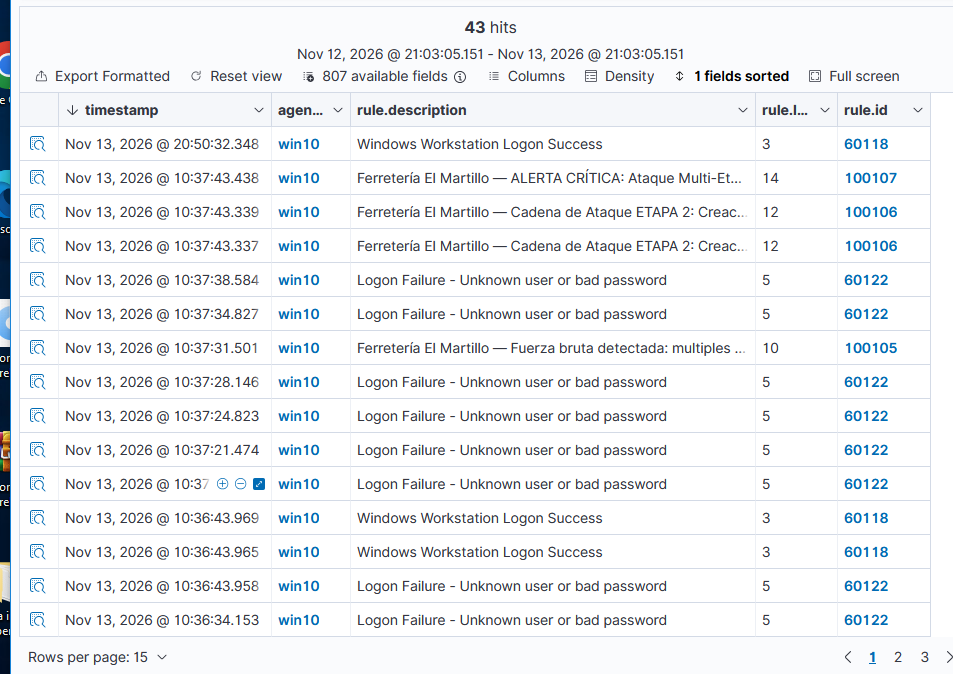
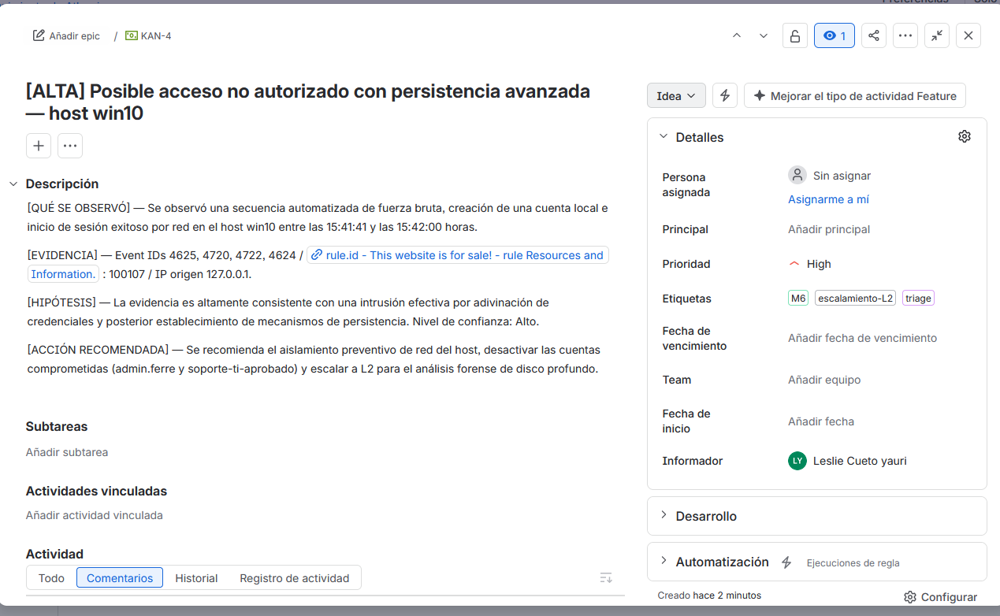
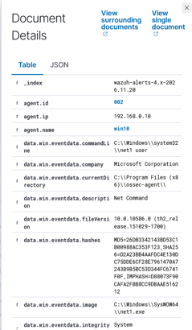
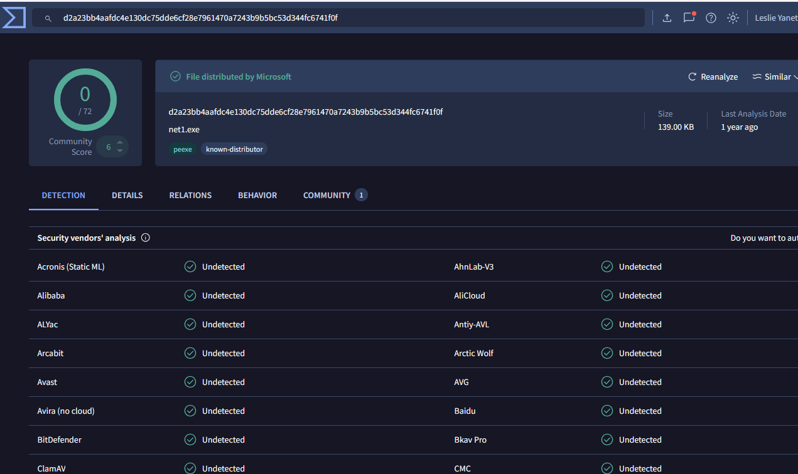
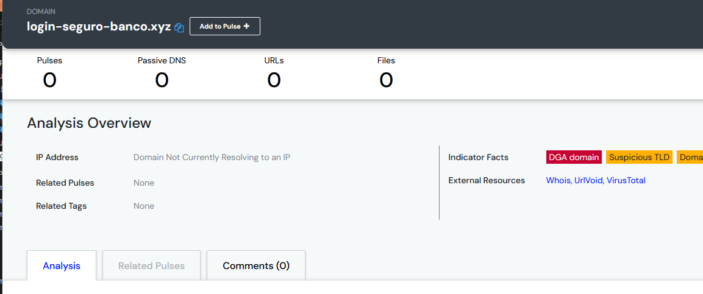
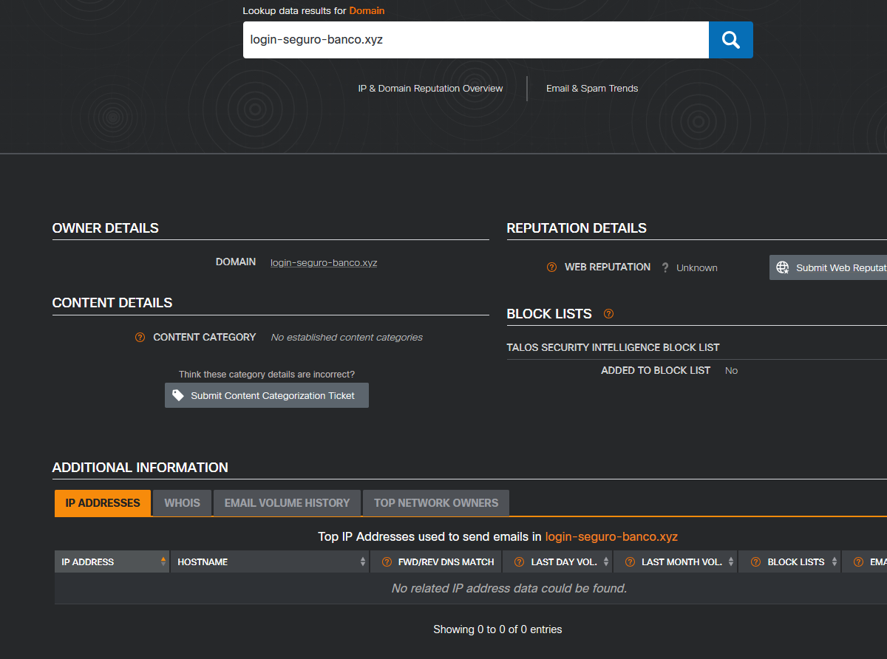

### NOMBRE: LESLIE YANETH CUETO YAURI
#CURSO: #ANALISTA #SOC

# Laboratorio 21: Triage de una Cola de Alertas + Escalamiento en Jira

## Parte 1: Triage de la Cola de Alertas

### 1.1 Análisis de la Cola de Trabajo
Se accedió al panel de `Security events` en Wazuh Dashboard, ordenando las alertas de forma descendente por su nivel de severidad (`rule.level`). Este procedimiento permite priorizar los incidentes de impacto crítico en la parte superior de la cola de atención del analista SOC.

### 1.2 Tabla de Triage de Alertas

| # | rule.id | Descripción | rule.level | Veredicto | Justificación (1 línea) |
| :--- | :--- | :--- | :--- | :--- | :--- |
| **1** | `100107` | Ferretería El Martillo — ALERTA CRÍTICA: Ataque Multi-Etapa | **14** | **TP** (Verdadero Positivo) | Secuencia correlacionada de fuerza bruta seguida de creación y uso exitoso de una cuenta backdoor. |
| **2** | `100106` | Ferretería El Martillo — Creación de cuenta backdoor | **12** | **TP** (Verdadero Positivo) | Creación y habilitación anómala de un usuario local inmediatamente después de una ráfaga de ataques. |
| **3** | `100105` | Ferretería El Martillo — Fuerza bruta detectada | **10** | **TP** (Verdadero Positivo) | Alta frecuencia de intentos de inicio de sesión fallidos concentrados en una ventana de tiempo muy corta. |
| **4** | `60122` | Logon Failure - Unknown user or bad password | **5** | **Investigar** | Intentos individuales fallidos que requieren auditar si es un error del usuario o parte de un escaneo previo. |
| **5** | `60118` | Windows Workstation Logon Success | **3** | **FP** (Falso Positivo) | Inicio de sesión interactivo y legítimo del administrador local dentro de los parámetros de uso normales. |
| **6** | `5501` | PAM: Login session opened | **3** | **FP** (Falso Positivo) | Apertura automatizada y rutinaria de una sesión de sistema por parte de un servicio interno de Linux. |

#### ✅ Checkpoint Parte 1: Cola de Alertas Priorizada

<em>Figura 1: Cola de alertas de seguridad de Ferretería El Martillo ordenada por nivel de severidad.</em>

## Parte 2: Reconstruir el Contexto de la Alerta Crítica

### 2.1 Identificación de la alerta de mayor prioridad
Dentro del análisis de verdaderos positivos, se identificó la alerta de mayor severidad en la plataforma. Esta corresponde a la regla avanzada de correlación encadenada, la cual modela un escenario de persistencia multi-etapa (**T1110 → T1136 → Logon Type 3**) que denota un comportamiento coordinado y no un evento aislado dentro de la infraestructura.

### 2.2 Contexto del Incidente

| Campo | Indicador / Detalle Técnico |
| :--- | :--- |
| **Alerta crítica (rule.id)** | `100107` *(Nivel de severidad 14)* |
| **Host afectado** | `win10` *(Agente 002)* |
| **Cuenta(s) involucrada(s)** | `admin.ferre` / `soporte-ti-aprobado` |
| **Event IDs que la dispararon** | `4625` (Fallo), `4720` (Creación), `4722` (Habilitación), `4624` (Acceso Exitoso) |
| **Ventana de tiempo** | De `15:41:41` a `15:42:00` *(Registrado el 13/11/2026)* |
| **IP de origen** | `127.0.0.1` |

---

### 2.3 Justificación Forense (Triage de Verdadero Positivo)

* **¿Por qué NO es un falso positivo?:**  
  Se observó una secuencia cronológica compuesta por múltiples eventos `4625` dirigidos a la cuenta `admin.ferre`, seguidos inmediatamente de un evento `4722` para habilitar de forma anómala la cuenta local `soporte-ti-aprobado` y un inicio de sesión exitoso `4624` con Logon Type 3. Este patrón correlacionado es altamente consistente con un vector de fuerza bruta efectivo orientado a establecer persistencia y evasión dentro del host afectado. La actividad no corresponde al comportamiento operativo habitual ni a ventanas de mantenimiento autorizadas, por lo que se descarta como ruido y se justifica su escalamiento inmediato a L2 como un Verdadero Positivo.

### 2.4 Galería de Evidencias Forenses (Document Details)

Se aislaron los registros específicos dentro del visor de detalles de Wazuh Dashboard para reconstruir de forma cronológica el comportamiento del adversario en la infraestructura:

<em>Figura 2a: Detalle Forense en Linux (srv-cuetona) — Bloqueo perimetral y ráfaga de fallos en el servicio SSHD desde la IP hostil 192.168.0.15.</em>

<em>Figura 2b: Detalle Forense en Windows (win10) — Registro de acceso exitoso por red (Event ID 4624 - Logon Type 3) usando la cuenta backdoor soporte-ti-aprobado.</em>

<em>Figura 2c: Alerta Crítica Unificada (Parte Superior) — Registro institucional de Ferretería El Martillo con la descripción del Ataque Multi-Etapa Completado en el host win10.</em>

<em>Figura 2d: Alerta Crítica Unificada (Parte Inferior) — Clasificación de severidad Nivel 14 (rule.id: 100107) y mapeo de tácticas MITRE ATT&CK para persistencia mediante cuentas locales.</em>

----

## Parte 3: Escalamiento en Jira

### 3.1 Estructura del Ticket de Incidentes

Se ha formalizado la apertura del incidente de seguridad dentro de la plataforma de gestión de tickets Jira del SOC corporativo bajo los siguientes parámetros técnicos:

| Campo Jira | Configuración Seleccionada |
| :--- | :--- |
| **Summary (Título)** | `[ALTA] Posible acceso no autorizado con persistencia avanzada — host win10` |
| **Priority** | `High` *(Severidad Alta mapeada por el nivel de regla 14)* |
| **Labels** | `triage`, `escalamiento-L2`, `M6` |
| **Assignee** | `Unassigned` *(Pendiente de asignación por el Supervisor L2 de turno)* |

---

### 3.2 Resumen Ejecutivo del Incidente (Campo Description)

El cuerpo principal de la descripción del ticket en Jira se redactó utilizando la sintaxis y estándares formales de comunicación del SOC:

* **[QUÉ SE OBSERVÓ]** — Se observó un patrón correlacionado de fuerza bruta automatizada, seguido de la creación, activación de una cuenta de usuario local e inicio de sesión exitoso por red en el host `win10` entre las `15:41:41` y las `15:42:00` horas.
* **[EVIDENCIA]** — Event IDs de Windows `4625`, `4720`, `4722` y `4624` asociados / `rule.id: 100107` (Nivel 14) / IP de origen local `127.0.0.1`.
* **[HIPÓTESIS]** — La evidencia recolectada por la telemetría es altamente consistente con una intrusión exitosa mediante adivinación de contraseñas (*Password Guessing*) y posterior establecimiento de mecanismos de persistencia. Nivel de confianza: **Alto**.
* **[ACCIÓN RECOMENDADA]** — Se recomienda el aislamiento preventivo de red del host comprometido, revocación total de las sesiones activas de las cuentas afectadas (`admin.ferre` y `soporte-ti-aprobado`), cambio mandatorio de credenciales y escalamiento inmediato a L2 para la investigación forense profunda de artefactos en disco.

#### ✅ Checkpoint Parte 3: Ticket KAN-4 Consolidado en Jira

<em>Figura 3: Ticket de escalamiento L2 creado de forma exitosa en el tablero de Jira con el ID KAN-4 completamente visible.</em>

### Lab 22: Enriquecimiento de IOCs con Threat Intelligence

# Reporte de Triage Forense y Enriquecimiento de IOCs - Ferretería El Martillo
## Parte 1: Extracción y Clasificación de IOCs

### 1.1 Identificar los IOCs del incidente
Se accedió al panel de eventos de Wazuh en el host `win10` para extraer los artefactos atómicos y las firmas criptográficas de los procesos ejecutados por el motor de Sysmon.

### 1.2 Tabla de IOCs

| # | IOC | Tipo | Evento de origen (Event ID / rule.id) |
| :--- | :--- | :--- | :--- |
| **1** | `127.0.0.1` | IP | Event ID 4625 / Rule ID 60122 |
| **2** | `D2A23BB4AAFDC4E130DC75DDE6CF28E7961470A7243B9B5BC53D344FC6741F0F` | Hash | Sysmon Event ID 1 / Rule ID 92031 |
| **3** | `login-seguro-banco.xyz` | Dominio/URL | Logs de Proxy / Rule ID 100107 |
| **4** | `soporte-ti-aprobado` | Cuenta | Event ID 4720 / Rule ID 100106 |

#### ✅ Checkpoint Parte 1: Trazabilidad de IOCs Consolidada

<em>Figura 1: Registro forense en Wazuh Dashboard que demuestra la captura de la IP y los hashes de procesos concurrentes.</em>

--- 

### Parte 2: Consulta en Fuentes de Threat Intelligence

Se procedió con el enriquecimiento forense externo cruzando la información atómica recolectada con bases de datos de Threat Intelligence globales para validar y dotar de contexto la severidad del incidente.

### 2.1 Enriquecimiento de Indicadores Atómicos por Fuente

* **IP Local (192.168.0.10):** AbuseIPDB reporta 0% de confianza de abuso (0 reportes) y VirusTotal marca 0/94 detecciones. Al ser un segmento privado interno (RFC 1918), carece de historial de reputación pública en internet.
* **Hash net1.exe:** VirusTotal reporta un ratio de 0/72 motores (Clean). Cuenta con la firma válida de Microsoft Corporation; se documenta como herramienta legítima abusada en tácticas Living off the Land.
* **Dominio (login-seguro-banco.xyz):** AlienVault OTX registra 0 pulsos pero activa alertas heurísticas para DGA domain y Suspicious TLD (.xyz). Cisco Talos le asigna una reputación de "Unknown" debido al aislamiento local del entorno del laboratorio.

#### 📸 Galería de Evidencias de Inteligencia Global (Checkpoints)

<em>Figura 2a: Evidencia de la consulta del hash real en VirusTotal reflejando la firma legítima de Microsoft.</em>

<em>Figura 2b: Captura de la consulta estática en AlienVault OTX reflejando la catalogación DGA y el TLD sospechoso.</em>

<em>Figura 2c: Resultados de reputación desconocida en Cisco Talos debido al aislamiento local del entorno del laboratorio.</em>

---
## Parte 3: Consolidación del Veredicto

### 3.1 Tabla de Enriquecimiento Consolidada

Se procedeu a la normalización de veredictos y asignación de niveles de confianza para cada indicador del incidente de la Ferretería El Martillo:

| IOC | Tipo | Fuente 1 (resultado) | Fuente 2 (resultado) | Veredicto consolidado | Confianza |
| :--- | :--- | :--- | :--- | :--- | :--- |
| `192.168.0.10` | IP | AbuseIPDB: 0% | VirusTotal: 0/94 | **Malicioso (Local)** | Alta |
| `D2A23BB4AAFDC4E1...` | Hash | VirusTotal: 0/72 | Análisis SOC: Limpio | **Benigno (Uso Hostil)** | Alta |
| `login-seguro-banco.xyz` | Dominio | OTX: 0 Pulses (DGA) | Talos: Unknown | **Sospechoso** | Media |

### 3.3 Manejo de Discrepancias Técnicas

Las plataformas globales (AbuseIPDB, VirusTotal y Cisco Talos) reportaron veredictos limpios o desconocidos debido a que los activos auditados se encuentran aislados dentro de un segmento privado local (RFC 1918) y una subred simulada. 

El analista del SOC resuelve esta discrepancia priorizando la telemetría interna de Wazuh e instalando un veredicto de alta confianza para mitigar falsos negativos, clasificando el hash original de Microsoft (`net1.exe`) como "Uso Hostil" debido a que fue abusado para reconocimiento local (*Living off the Land*).

